# Roadmap de features: prioridades e dependências

Data: 19/10/2026. Status: roadmap; progresso registrado por item.

Objetivo: entregar melhorias úteis em incrementos pequenos, reaproveitando o core
Rust e mantendo o funcionamento local independente de integrações externas.
Ordem proposta para desenvolvimento individual, priorizando o cliente macOS;
domínio, persistência e contratos compartilhados permanecem no core.

Revisão de 26/10/2026: busca de catálogo, múltiplas origens e plugins foram
consolidados no [roteiro unificado de integrações musicais](roteiro-integracoes-musicais.md).
A fundação de catálogo precede descoberta externa. A numeração abaixo organiza
as melhorias locais; as dependências incrementais das integrações estão no roteiro único.

## Bases identificadas no projeto

- A Home atual oferece atalhos para músicas, álbuns, artistas e playlists.
- Já existem histórico persistente, datas de criação na biblioteca, avaliações,
  favoritos e sinalização `suggest_less`.
- Playlists comuns e inteligentes já oferecem uma base para reutilizar conceitos
  de regras, sem converter coleções de álbuns em playlists de faixas.
- A sessão persiste `source_context`, incluindo `release:42` e `playlist:7`.
  Isso ajuda no destaque contextual; ainda é preciso verificar sua propagação
  por todos os caminhos de reprodução e a identidade de ocorrências repetidas.
- A descrição salva do Replay é um texto fixo no cliente macOS.
- Atalhos possuem definições centralizadas em `AppKeyboardShortcuts.swift` e
  comandos em `AppCommands.swift`; a tarefa é ampliar e completar essa base.
- A tabela `genres` e metadados de gêneros já existem. Evitar um catálogo paralelo.
- Enriquecimento externo já tem fronteiras próprias no core.

Planos relacionados, ainda propostas e não pré-requisitos integralmente prontos:

- [Gêneros e navegação](roteiro-generos-navegacao.md).
- [Catálogo, múltiplas origens e plugins](roteiro-integracoes-musicais.md).

## Ordem recomendada

P0 = corrigir comportamento atual; P1 = próxima entrega de valor local;
P2 = organização e descoberta local; P3 = descoberta externa e extensibilidade.
Esforço relativo: pequeno, médio ou grande; não representa prazo de calendário.
As dependências abaixo distinguem requisitos obrigatórios de melhorias opcionais.

| Ordem | Prioridade | Entrega | Dependência obrigatória | Esforço |
| --- | --- | --- | --- | --- |
| 1 | P0 | Destacar a faixa somente na origem de reprodução | Contexto e ocorrência de reprodução confiáveis | Pequeno–médio |
| 2 | P1 | Home: escutas recentes e recentemente adicionados | Consultas de histórico e data de entrada na biblioteca | Médio |
| 3 | P1 | Ampliar atalhos e torná-los descobríveis | Inventário dos comandos e tratamento de foco | Pequeno–médio |
| 4 | P1 | Tags pessoais: cadastro, edição, remoção, associação e filtros | Definição dos alvos e migração aditiva | Médio–grande |
| 5 | P1 | Listen List manual | Identidade estável do lançamento e persistência | Médio |
| 6 | P2 | Gêneros e estilos: navegação local | Classificação efetiva consultável e normalização mínima | Médio–grande |
| 7 | P2 | Descrição musical do Replay | Agregação dos gêneros disponíveis nas faixas selecionadas | Pequeno–médio |
| 8a | P2 | Coleções de álbuns manuais | Modelo de coleção, ordenação e reprodução de álbuns | Médio |
| 8b | P2 | Coleções de álbuns inteligentes | 8a e regras de filtro em nível de lançamento | Médio–grande |
| 9 | P2 | Recomendações locais + bloco na Home | Seleção de candidatos e sinais locais consultáveis | Grande |
| 10 | P3 | Seguir artistas, monitorar novidades e mostrar na Home | Identidade externa, preferências de acompanhamento e atualização incremental | Grande |
| 11 | P3 | Expandir integrações opcionais pelo sistema de plugins | Registro mínimo e piloto antecipados na trilha de integrações; expansão por capacidade | Grande |

Antes da execução, uma decisão curta de domínio resolve a diferença entre álbum,
lançamento e edição, além de uma proposta curta definir os contratos de plugins.
Isso não exige implementar um sistema de plugins antes das entregas 1–9.

## Dependências que realmente bloqueiam

```mermaid
flowchart TD
    Contexto[Contexto e ocorrência de reprodução] --> Destaque[Destaque apenas na origem]
    Historico[Histórico de escuta] --> Home[Home: escutas recentes]
    Entrada[Data de entrada na biblioteca] --> Adicionados[Home: adicionados recentemente]
    Identidade[Identidade de lançamento e edição] --> Tags[Tags pessoais]
    Identidade --> Listen[Listen List manual]
    Identidade --> Colecoes[Coleções manuais de álbuns]
    Colecoes --> Inteligentes[Coleções inteligentes]
    Regras[Regras de filtro para lançamentos] --> Inteligentes
    Classificacao[Gêneros e estilos consultáveis] --> Generos[Páginas de gêneros e estilos]
    Classificacao --> Replay[Descrição musical do Replay]
    Sinais[Histórico e preferências locais] --> Recomendacoes[Recomendações locais]
    Recomendacoes --> HomeRec[Home: recomendações]
    Externa[Identidade externa e atualização incremental] --> Novidades[Novidades dos artistas seguidos]
    Seguir[Seguir artistas] --> Novidades
    Novidades --> HomeNov[Home: novidades]
    Contratos[Contratos e ciclo de vida de plugins] --> Plugins[Integrações opcionais]
    Origens[Múltiplas origens de mídia] --> Remotas[Plugins de reprodução remota]
    Plugins --> Remotas
```

Tags e gêneros ampliam filtros e recomendações, mas não são pré-requisitos para
uma Listen List manual, coleções manuais ou recomendações baseadas em histórico.
O Replay pode ganhar uma primeira descrição usando os gêneros atuais, antes da
navegação completa por gêneros. Novidades não precisam do recomendador.

## Fase 1 — Comportamento e acesso

### 1. Destaque contextual da faixa

Implementado em 19/10/2026. Ver [contrato e validação](features/contextual-track-highlighting.md).

- Usar identidade da faixa + contexto de origem + ocorrência quando aplicável.
- A mesma faixa em um álbum e em uma playlist só recebe destaque na origem ativa.
- Uma playlist que repete a faixa destaca somente a ocorrência ativa.
- Navegar para outra página não muda a origem; iniciar outra reprodução muda.
- Definir contexto para busca, biblioteca, fila, Home e futuras coleções. Origem
  de navegação não é a origem local/remota do áudio.
- Validar pausa, avanço automático, shuffle, restauração e edição da fila.

Conclusão: não há destaque indevido em outras listagens e os controles globais
continuam identificando a faixa em reprodução.

### 2. Home local

- Entregar escutas recentes e itens adicionados recentemente como blocos separados.
- Definir se o bloco de escutas mostra faixas, álbuns ou ambos; sugestão inicial:
  álbuns únicos ordenados pela última escuta, com acesso ao histórico completo.
- Definir adição como primeira entrada na biblioteca, preservada em rescan e
  enriquecimento. Não confundir com data do lançamento ou criação no catálogo externo.
- Consultas limitadas, ordenação estável, invalidação após mudanças e estados vazios.
- Ao reproduzir um álbum pelo cartão, usar contexto do álbum; mixes próprios da
  Home precisam de contexto próprio.

Conclusão: os dois blocos funcionam offline e se atualizam após escuta/importação.

### 3. Atalhos

- Inventariar os existentes e completar reprodução, navegação, busca, fila,
  seleção, edição e criação de listas conforme as ações disponíveis.
- Concentrar comandos e disponibilidade; expor combinações nos menus e em ajuda.
- Respeitar campos de texto, seleção, controles focados e convenções da plataforma.
- Validar as combinações finais nas diretrizes de cada plataforma durante a
  implementação; este roteiro não define um suposto padrão universal da indústria.

Conclusão: comandos principais são acessíveis por teclado sem interceptar digitação.

## Fase 2 — Organização pessoal

### 4. Tags pessoais

- Tags são categorias livres do usuário, distintas de gêneros, estilos e tags
  embutidas nos arquivos. Começar como dados internos, sem escrever nos arquivos.
- Separar renomear uma tag, remover sua associação e excluir a tag de todos os itens.
- Propor `user_tags`, `track_user_tags` e `release_user_tags`, com FKs, unicidade
  por associação e índices para consulta nos dois sentidos.
- No modelo atual, álbum é uma categoria de lançamento: confirmar esse escopo
  antes de criar uma terceira associação redundante para álbuns.
- Se a distinção conceitual entre álbum e edição for introduzida, explicitar se
  uma associação pertence ao agrupamento ou à edição, sem propagação silenciosa.
- UI: chips, autocomplete, edição em lote e filtros combinando qualquer/todas as
  tags. Renomear deve atualizar todos os usos; scans não apagam escolhas pessoais.
- Reutilizar o mecanismo de filtros em coleções inteligentes e recomendações.

Conclusão: criar, associar, desassociar, renomear, excluir e filtrar funcionam em
faixas e lançamentos, inclusive álbuns, com persistência após reiniciar e rescan.

### 5. Listen List

- Página de lançamentos que o usuário deseja ouvir, com ação nos cartões e menus.
- Tabela proposta `listen_list_entries`: lançamento, data de inclusão e estado;
  impedir duplicidade do mesmo alvo. Tags e notas podem ser incrementos posteriores.
- Primeiro incremento: adicionar, remover, ordenar e marcar como ouvido manualmente.
- Segundo: detectar conclusão e oferecer marcar como ouvido; manter itens ou
  arquivá-los, sem apagar silenciosamente. Automação pode ser preferência posterior.
- Definir conclusão considerando todas as faixas da edição, discos, skips e
  escutas em sessões diferentes. Contagem de plays isolada não prova escuta integral.
- Itens externos sem arquivos dependem de referências persistentes ao catálogo;
  não dependem de streaming para entrar na lista.

Conclusão: a lista manual é útil sozinha; detecção automática é uma entrega separada.

## Fase 3 — Exploração e curadoria local

### 6. Gêneros e estilos

- Executar o roteiro específico em incrementos, começando pela navegação local.
- Página de gêneros, detalhe por gênero e detalhe por estilo com conteúdo disponível.
- Não exigir toda a integração Discogs/MusicBrainz para disponibilizar a página.
- Primeiro mostrar “Bem avaliados na sua biblioteca”, usando avaliações pessoais.
  Ranking externo é outro incremento, com fonte de avaliações explicitamente escolhida.
- Preservar correções pessoais e separar evidência direta, herança e procedência.

### 7. Descrição do Replay

- Gerar resumo determinístico a partir das faixas realmente selecionadas e dos
  gêneros/estilos disponíveis. Não requer IA nem recomendador.
- Evitar que uma classificação herdada do álbum vire evidência direta da faixa;
  explicitar a política de agregação e evitar dupla contagem.
- Exemplo de formato: “Seu mês entre jazz e soul, com passagens por funk.”
- Sem metadados suficientes, usar texto genérico; não inventar estilos.
- Preservar descrição editada pelo usuário. No modo dinâmico, atualizar apenas
  descrições ainda geridas pelo app quando a seleção mudar.

### 8. Coleções de álbuns

- Nome de interface sugerido: **Coleções de álbuns**. Playlist organiza faixas;
  coleção organiza lançamentos completos, com identidade e ordem próprias.
- Não confundir com o conjunto de toda a biblioteca ou com a intenção de ouvir
  da Listen List. Um lançamento pode participar de várias coleções.
- Primeiro criar página central, detalhe, coleção manual, edição e ordenação.
- Propor `album_collections` e `album_collection_items`; modo inteligente pode
  guardar definição em `album_collection_rules`, sem reutilizar `playlist_songs`.
- Depois adaptar regras para lançamento: gênero, estilo, tags, ano, artista,
  avaliação e estado de escuta. Definir se avaliação é do álbum ou derivada das faixas.
- Fixar que “contém faixa com tag X” difere de “álbum possui tag X”.
- Reprodução respeita ordem dos álbuns e discos/faixas. Distinguir embaralhar
  álbuns de embaralhar faixas; registrar contexto da coleção e do item ativo.
- Definir tratamento de edição indisponível e mudanças nos resultados inteligentes
  durante a reprodução, evitando alterar inesperadamente a fila já iniciada.

Conclusão: coleções manuais e inteligentes são entregas independentes; a primeira
não espera pela implementação de todos os filtros.

## Fase 4 — Descoberta

### 9. Recomendações locais

- Começar por regras transparentes sobre a biblioteca: histórico, avaliações,
  favoritos, pouca escuta, recência e `suggest_less`.
- Gêneros, estilos e tags enriquecem a afinidade quando disponíveis.
- Definir unidade da sugestão, candidatos elegíveis, diversidade e repetição;
  sugestão inicial: álbuns, com motivo como “de um artista que você ouve”.
- Sem histórico, oferecer exploração da biblioteca com rótulo apropriado.
- Excluir conteúdo oculto/indisponível e permitir dispensar sugestões.
- Medir se as sugestões levam a escutas; pesos e critérios são hipóteses de
  produto, não uma garantia de qualidade do algoritmo.
- Entregar motor e bloco da Home juntos. Descoberta fora da biblioteca fica para
  outro incremento, exigindo catálogo externo e ação útil para o item sugerido.

### 10. Novidades dos artistas seguidos

- Seguir artista é uma preferência explícita, distinta de favoritar.
- Persistir acompanhamento, estado de atualização, identidade externa e itens vistos.
- Definir “novidade”: lançamento recente, anúncio futuro ou nova edição; não tratar
  entrada tardia em um banco externo como lançamento ocorrido agora.
- Atualização incremental, cache, deduplicação de edições e cancelamento ao deixar
  de seguir. Exibir fonte e última atualização; cobrir funcionamento offline.
- Validar cobertura, termos, limites e autenticação dos provedores antes de escolher
  MusicBrainz, Discogs ou outro. Este roteiro não presume que sejam feeds completos.
- Começar com um provedor; incluir ação de adicionar à Listen List.

Conclusão: artistas seguidos geram novidades identificadas e deduplicadas; falha
do provedor não impede navegar, organizar ou reproduzir a biblioteca.

## Trilha de arquitetura — Plugins

O planejamento detalhado está no [roteiro unificado de integrações musicais](roteiro-integracoes-musicais.md).
As etapas 1 e 2 foram concluídas em 27/10/2026: contratos de identidade e registro
mínimo interno com ciclo de vida, configuração, credenciais e tarefas canceláveis.
Ver [contrato do runtime](features/music-plugin-runtime.md). Provedores reais e
busca de catálogo seguem nas próximas etapas.
Ele define contratos e registro mínimo cedo, busca de catálogo antes de streaming,
migração aditiva de origens, um provedor piloto e expansão por capacidade.

Busca Soulseek pode ser entregue independentemente da reprodução; transferências
e importação entram depois. Plugins de metadados e novidades não dependem da
migração de múltiplas origens. O runtime inicial usa adaptadores mantidos pelo
projeto; marketplace e código arbitrário de terceiros ficam para decisão futura.

## Recorte sugerido para começar

**Fundação de descoberta:** revisar contratos de identidade e capacidades → busca
de catálogo local/externo → detalhes progressivos e seleção persistente. A busca
não depende de streaming e Last.fm não é uma etapa obrigatória. Essa fundação
precede Listen List externa, recomendações externas e novidades.

**Primeiro ciclo local:** destaque contextual → dois blocos locais da Home → atalhos.

**Segundo ciclo:** tags pessoais → Listen List manual.

**Terceiro ciclo:** navegação local de gêneros → descrição do Replay → coleções
manuais → coleções inteligentes.

**Quarto ciclo:** recomendações locais → novidades externas. Contratos de plugins
podem ser desenhados antes; runtime e integrações entram conforme a capacidade exigir.

**Trilha de acesso à música:** seguir as etapas do [roteiro unificado](roteiro-integracoes-musicais.md):
contratos e registro mínimo → busca e detalhes → múltiplas origens → um provedor
de reprodução → expansão. Provas técnicas começam cedo; pesquisa Soulseek pode
avançar sem streaming, com transferências depois. Antecipar essa trilha à expansão
de recomendações externas.

Sem estimar semanas antes de fechar o escopo de cada entrega. Cada item que altera
persistência inclui migração e validação de preservação de dados; mudanças da API
do core incluem atualização dos bindings e compatibilidade dos consumidores.
