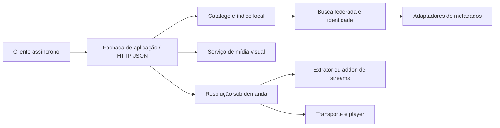

# Roteiro de refatoração: adaptadores sem chaves e mídia visual

Data: 29/10/2026. Status: **planejado; nenhuma etapa R1–R12 implementada por este documento**.

Revisão de arquitetura em 29/10/2026: incorporar as cinco decisões propostas a
partir do Stremio — HTTP/JSON cacheável, IDs estáveis, serviço de imagens, índice
de busca e cliente assíncrono — com as adaptações musicais descritas na seção 4.

Este roteiro define o próximo incremento do
[plano unificado](roteiro-integracoes-musicais.md), após a decisão de não fornecer
chaves pessoais de API. Abrange busca, coleções e streaming público de YouTube e
SoundCloud, além de retratos, vídeos de apresentação e capas de álbuns/singles.
O histórico das entregas anteriores continua válido; preparação de testes de APIs
autenticadas não equivale à implementação destes novos adaptadores.

## 1. Decisões de produto

- O fluxo principal deve funcionar sem cadastro de aplicativo, chave pessoal,
  token colado na interface ou assinatura de desenvolvedor pelo usuário.
- Começar com conteúdo público. Não ler cookies do navegador automaticamente,
  automatizar login nem prometer acesso a conteúdo privado, pago ou restrito.
- Diferenciar serviço de origem, adaptador técnico e modo de reprodução. Uma
  faixa SoundCloud continua sendo a mesma origem ao trocar OAuth por extrator.
- Consultar, revisar, salvar, reproduzir e baixar são ações distintas. Resolução
  temporária de stream não importa um arquivo para a biblioteca.
- O núcleo Rust mantém identidade, fila, ocorrências, sessão e histórico. Um
  processo auxiliar descobre metadados/mídia e não controla o player ou o banco.
- Imagens e vídeos têm procedência e política de uso próprias. URL pública não
  significa licença livre, retrato oficial, arquivo permanente ou autorização de
  uso como fundo animado. Uma miniatura de vídeo não vira retrato de artista.
- Spotify e Apple Music devem ser avaliados como fornecedores opcionais. As APIs
  autenticadas não podem voltar a ser pré-requisito do fluxo sem chaves. A inclusão
  desses nomes no roteiro não promete que todos serão habilitáveis neste modo.
- Reprodução local e Soulseek continuam independentes dos extratores e do
  enriquecimento visual. Indisponibilidade externa não bloqueia a biblioteca.

## 2. Base real a reaproveitar

| Área | Estado observado e ponto de mudança |
| --- | --- |
| Origens e domínio | `durvald-core/src/domain/music/sources.rs` já distingue referência persistente e mídia resolvida temporária. Evoluir o contrato existente. |
| Plugins | `application/music_plugins/` tem permissões, flags, credenciais, cancelamento e diagnóstico. Acrescentar dependências de extrator e capacidades verificadas. |
| Coleções | `application/service_collections.rs`, `infrastructure/public_services/` e o repositório SQLite já tratam capturas, ordem, ocorrências, cache, cancelamento e recibos. Substituir o acesso técnico sem reescrever a importação. |
| Players | `application/playback_sources.rs`, `application/playback_embedded.rs` e o controlador Swift já coordenam modos incorporados e áudio local. Acrescentar o modo remoto nativo validado. |
| Transporte | `audio/decoder.rs` abre arquivos; a configuração atual não comprova AAC/Opus nem transporte HTTP/HLS. A antiga etapa 9A volta a ser necessária para o áudio direto. |
| Enriquecimento | `enrichment/providers/{musicbrainz,wikidata,commons,cover_art_archive,lastfm}.rs`, scheduler, cache negativo e fila persistente de capas já existem. Last.fm tem condições próprias de acesso. |
| Imagens no macOS | `Features/Player/ArtworkRepository.swift`, `ArtworkView.swift` e `Features/Library/ArtistPresentation.swift` são pontos de integração; conferir seus consumidores antes de alterar DTOs. |
| Provas | Reutilizar `tools/provider-probes/`, bibliotecas isoladas e recibos. O executor de APIs autenticadas permanece como ferramenta opcional histórica. |
| Índice local | `database/operations.rs::ensure_search_indexes` já cria FTS5 trigram para músicas, lançamentos, artistas e playlists; `infrastructure/sqlite/catalog_search.rs` o consome. Evoluir essa base antes de adicionar infraestrutura externa. |

Confirmar este inventário na R1. O
[roteiro de enriquecimento](roteiro-melhorias-enriquecimento.md) continua responsável
pelas regras existentes de SQLite, filas, cache e atribuição.

## 3. Matriz de fornecedores

### Busca, coleções e áudio

| Fornecedor/modo | Estratégia proposta | Condição de aceitação |
| --- | --- | --- |
| YouTube por extrator | Avaliar yt-dlp para busca, metadados, playlists e resolução sob demanda. | Prova real independente para cada capacidade, formatos e dependências; nenhum requisito de chave pessoal. |
| SoundCloud por extrator | Avaliar primeiro o suporte mantido pelo yt-dlp; se faltar capacidade, adaptador específico de dados públicos. | Provar faixa, busca, playlist e prévia/bloqueio separadamente. Identificador obtido pelo extrator não deve virar configuração manual do usuário. |
| Players incorporados | Manter YouTube IFrame e SoundCloud Widget como modos disponíveis. | Escolha explícita do modo; não assumir que incorporação comprova busca nem áudio direto. |
| Bandcamp | Preservar o leitor público atual e avaliar apenas lacunas observadas. | Nenhuma regressão na captura de metadados; streaming direto é capacidade independente. |

O [plugin YouTube do Nuclear](https://github.com/NuclearPlayer/nuclear-plugin-youtube)
documenta uso de yt-dlp; o
[plugin SoundCloud](https://github.com/NuclearPlayer/nuclear-plugin-soundcloud)
documenta descoberta de um client ID do site e streaming HLS. São referências de
arquitetura, não evidências de funcionamento no Durvald. Não copiar código sem
verificar sua licença e compatibilidade com o projeto.

### Retratos, capas e vídeos

| Fonte | Uso planejado | Acesso e limites a validar |
| --- | --- | --- |
| Arquivo escolhido pelo usuário e arte embutida | Retrato, capa e, futuramente, vídeo local de apresentação. | Prioridade sobre atualizações automáticas; não substituir a escolha pessoal. |
| MusicBrainz + Cover Art Archive | Identidade e capa da edição; fallback identificado para release-group. | Base pública sem chave pessoal. Não confundir capa de grupo com capa exata de uma edição. |
| Wikidata + Wikimedia Commons | Retrato associado à identidade; vídeo apenas quando houver arquivo adequado e vínculo verificável. | Preservar autor, licença e URL de atribuição de cada arquivo. Disponibilidade de vídeo é opcional. |
| Deezer | Avaliar imagens de artista e capas de álbum/faixa em endpoints públicos. | Documentação consultada redirecionou a login; disponibilidade sem token e campos devem ser comprovados. Não assumir que cadastro de app esteja disponível ou necessário. |
| iTunes Search/Lookup | Candidato a capas e referências de álbum/single por ID e loja/região. | Requisições documentadas não exigem chave pessoal, mas imagens/prévias têm condições promocionais. Só integrar o uso compatível; não é banco livre de retratos ou vídeos de perfil. |
| Spotify Web API | Imagens de artista e capas de lançamentos por ID. | Exige autenticação. Condicional a acesso autorizado e compatibilidade com um player de múltiplas fontes; não utilizar como banco genérico de imagens por padrão. |
| Apple Music API/MusicKit | Artwork de artista e de lançamentos por catálogo/storefront. | Exige autorização de desenvolvedor. Avaliar a geração automática do MusicKit no macOS e limites de distribuição; não exigir chave do usuário nem embutir chave privada no app. |
| fanart.tv, TheAudioDB e outras fontes | Pesquisa futura se restar lacuna de retratos/capas. | Antes de adotar, verificar API, autenticação, licença, disponibilidade e limites. Não presumir acesso anônimo. |

A [API de artistas Spotify](https://developer.spotify.com/documentation/web-api/reference/get-an-artist)
expõe imagens e requisitos de atribuição. Sua
[política](https://developer.spotify.com/policy) inclui restrições à integração com
conteúdo de outros serviços; a adequação ao produto precisa ser resolvida antes
de habilitar o adaptador. Não tratar crop, derivação de cores e cache como
operações permitidas para todas as fontes.

A Apple documenta [artwork de artista](https://developer.apple.com/documentation/applemusicapi/artists/attributes-data.dictionary)
e [tokens de desenvolvedor](https://developer.apple.com/documentation/applemusicapi/generating-developer-tokens).
O [iTunes Search](https://performance-partners.apple.com/search-api) é uma API
diferente, com condições promocionais próprias. **Não foi identificado nesta
pesquisa um contrato público que permita prometer vídeo de perfil/Canvas para
todos os artistas.** Capas animadas, videoclipe, teaser e retrato em movimento
precisam ser capacidades distintas; endpoint privado ou campo não documentado
não é compromisso de produto.

## 4. Contratos propostos

Os nomes abaixo são propostas internas, não novos tipos já disponíveis na API.

| Contrato | Responsabilidade |
| --- | --- |
| `AdapterCapabilities` | Serviço, adaptador, versão, acesso exigido, dependências e capacidades observadas: busca, coleção, áudio, prévia, imagem e vídeo. |
| `ExtractorRequest` / `ExtractorResult` | Operação e argumentos estruturados, paginação/lote, limite, cancelamento, resposta normalizada e falha tipada. Sem comandos livres. |
| `ResolvedStreamLease` | Referência estável, protocolo, MIME/container/codec observados, headers temporários, expiração quando conhecida e capacidades de seek/duração. Evoluir `ResolvedMedia`, evitando duplicação. |
| `VisualAssetCandidate` | Entidade alvo, referência do fornecedor, papel visual, imagem/vídeo, dimensões, duração, poster, origem, loja/região, vínculo de identidade, atribuição e permissões de apresentação/cache. |
| `VisualAssetSelection` | Seleção ativa por entidade/papel, prioridade pessoal, motivo do vínculo, revisão e regra de atualização. |
| `AdapterFailure` | Dependência ausente/incompatível, conteúdo não encontrado, prévia, restrição, timeout, limite, formato não suportado, resposta inválida e mudança de contrato. |
| `AddonManifest` | Versão do contrato, recursos `catalog`/`meta`/`stream`/`visual`, tipos de entidade, namespaces de IDs, acesso, paginação, limites e diretivas de cache; extensão do manifesto existente. |
| `SearchEnvelope` | Query original/normalizada, geração, seções por entidade, procedência, cursor por fonte, conclusão parcial, falhas independentes e versão do ranking. |
| `ExternalIdentityMapping` | Tipo da entidade, namespace/ID externo, ID interno estável, evidência, confiança e origem da associação; resolução de conflitos e aliases. |
| `VisualAssetManifest` | Hash/revisão da seleção, variantes permitidas, dimensões, formato, placeholder permitido e política de cache/atribuição. |
| `AvailabilityObservation` | Origem, região/loja quando conhecida, acesso integral/prévia/restrito/desconhecido, causa, instante e validade; não representa licença jurídica inventada pelo app. |

Separar o que pode ser persistido do que é apenas uma autorização temporária de
acesso. Não guardar URLs assinadas, cookies ou headers no histórico, sessão,
referência canônica, DTO de interface ou recibo compartilhável. Cache binário de
imagem/vídeo só existe quando a política da fonte o permitir; URL efêmera expirada
exige nova resolução, não edição do ID canônico.

### 4.1 Arquitetura inspirada no Stremio

O Stremio documenta [manifestos e recursos](https://stremio.github.io/stremio-addon-sdk/api/responses/manifest.html),
[catálogo/busca](https://stremio.github.io/stremio-addon-sdk/api/requests/defineCatalogHandler.html)
e [resolução de streams](https://stremio.github.io/stremio-addon-sdk/api/requests/defineStreamHandler.html)
como contratos separados. O Durvald adotará essa separação de responsabilidades;
as rotas e os tipos musicais abaixo são um protocolo próprio versionado, sem
promessa de compatibilidade direta com addons de vídeo do Stremio.

Começar com serviços lógicos no aplicativo e gateway HTTP restrito a loopback.
O cliente nativo pode continuar chamando a mesma aplicação por UniFFI; endpoints
HTTP não devem duplicar regras nem exigir uma ida à rede para cada leitura local.
CDN, cache de borda, cluster de busca e servidor público são uma extensão futura,
condicionada a volume, operação e conteúdo que possa ser distribuído. A biblioteca
pessoal não é publicada para obter cache compartilhado.

### 4.2 Decisão 1 — Catálogo e busca por HTTP + JSON cacheável

Rotas propostas, sob `/v1`, com schemas e erros estáveis:

| Método e rota | Resultado e política |
| --- | --- |
| `GET /manifest.json` | Recursos, tipos, versões e limites suportados pelo addon/gateway. |
| `GET /search?q=radiohead&type=artist,album,track&limit=20` | Seções incrementais por tipo/fonte e cursores opacos; incluir playlist quando solicitada. |
| `GET /artist/{id}` | Identidade, créditos, relações e referências visuais. |
| `GET /album/{id}` | Release-group e edição escolhida explicitados, tracklist e capa correspondente. |
| `GET /track/{id}` | Gravação, contexto de lançamento quando houver e origens conhecidas; nenhum stream resolvido. |
| `GET /stream/track/{id}` | Candidatos estáveis e capacidades; não iniciar extração de mídia para preencher cards. |
| `POST /playback/resolve` | Seleção de origem → identificador opaco da tentativa/lease para o transporte confiável; `no-store`. URLs e headers temporários ficam fora da interface comum. |
| `GET /visual/{entityType}/{id}` | Manifesto da seleção atual e variantes; validade curta/ETag. |
| `GET /cover/{albumId}/{assetHash}/300.webp` | Variante cujo conteúdo é versionado; cache longo apenas quando permitido. |

Estas rotas são do gateway Durvald; cada addon anuncia o subconjunto de recursos
que realmente oferece. Respostas de addon remoto contendo URLs de mídia são
consumidas pelo resolvedor confiável e convertidas em leases internas, sem passar
por cache público de catálogo ou logs.

Chave de cache: query normalizada + tipos + idioma + região/loja + fontes/flags
habilitadas + versão do schema/ranking + geração do catálogo + cursor/limite.
Preservar a query original; normalizar caixa, acentos e espaços auxilia recuperação,
não identidade. Não juntar consultas cujo sentido ou escopo seja diferente.

Política inicial a medir: busca pública por até 5 minutos; detalhes públicos por
até 1 hora, se a fonte permitir. Usar ETag/validação condicional e TTLs menores
para falhas/ausências; respeitar política mais restritiva do fornecedor. Escritas
locais invalidam a geração afetada após o commit. Fontes remotas usam TTL ou evento
de atualização real quando oferecido. Resposta parcial explicita fontes pendentes
e não é publicada como resultado completo no cache compartilhado.

Biblioteca, favoritos, histórico, playlists privadas e buscas combinadas com esses
dados usam cache local/`private`; consultas sensíveis podem exigir `no-store`.
Se houver serviço hospedado futuramente, somente respostas públicas equivalentes
entre usuários poderão compartilhar cache de borda. Não usar `public` em resposta
que dependa de conta, autorização, biblioteca ou região não representada na chave.

### 4.3 Decisão 2 — Identidade musical em camadas

| Camada | Representação proposta e vínculo |
| --- | --- |
| Artista/crédito | ID interno estável; MBID de artista e referências dos serviços, com créditos múltiplos. |
| Obra | `works`, opcional quando desconhecida; composição e relações com gravações, inclusive arranjos/medleys. |
| Gravação | `recordings`; gravação identificada, referências MusicBrainz e ISRC como evidência externa. |
| Grupo de lançamento | Agrupamento de álbum/single e variantes; não escolhe sozinho a capa de uma edição. |
| Lançamento/edição | Entidade de release existente, com região, data, formato e referências MBID/UPC/EAN. |
| Faixa no lançamento | `release_tracks` ou evolução do vínculo existente: edição + disco + posição + gravação + crédito/título contextual. |
| Faixa pessoal e ocorrência | Preservar `songs.song_id`, preferências e origens; ocorrências de playlist/fila continuam distintas da posição no lançamento. |

O schema final será decidido na R2 após mapear as relações existentes; os nomes
propostos não autorizam recriar `songs` ou perder seus IDs. IDs públicos do gateway
serão opacos e namespaced; IDs de SQLite não são identificadores globais entre
bibliotecas. Manter aliases e mapeamentos para IDs externos, sem exigir que todo
item tenha MBID, obra, ISRC ou código de barras para existir.

ISRC e UPC/EAN são evidências úteis, não constraints universais de unicidade.
Preservar conflitos, identificadores ausentes e relações múltiplas. A associação
externa exata é tipada por entidade/namespace; a associação incerta permanece
candidata até revisão. Agrupar resultados equivalentes para apresentação não
mescla gravações, edições, remasters ou dados pessoais no banco.

O resultado principal pode apresentar uma versão preferida conforme identidade,
contexto da busca e escolha do usuário, mantendo as demais acessíveis. Popularidade
não torna uma versão canônica nem permite substituir uma gravação por cover.
Esta separação segue os conceitos de [obra](https://musicbrainz.org/doc/Work),
[edição](https://musicbrainz.org/doc/Release) e
[faixa em lançamento](https://musicbrainz.org/doc/Track) do MusicBrainz.

### 4.4 Decisão 3 — Serviço dedicado de imagens e placeholders

Separar obtenção do original permitido, validação, transformação, seleção e
entrega das variantes. Inicialmente é um serviço local com cache em disco; uma
implantação em servidor poderá usar o mesmo contrato, quando justificada.

- Gerar tamanhos 64, 300 e 640 px de forma limitada e deduplicada por hash,
  preservando proporção. WebP é candidato inicial com fallback JPEG/PNG; AVIF
  depende de codec, custo de geração e suporte dos clientes comprovados.
- Imutabilidade pertence ao conteúdo/variante versionados por hash. A capa escolhida
  para um lançamento pode mudar por correção ou decisão pessoal: o manifesto aponta
  para novo hash e é revalidável. Não aplicar `immutable` à URL mutável por albumId.
- Quando a fonte permitir, servir variantes com `max-age` longo e `immutable`;
  o hash considera conteúdo e parâmetros de transformação. Expiração, retirada e
  restrições do fornecedor prevalecem sobre a retenção pretendida.
- Incluir cor dominante ou blurhash no JSON somente quando a transformação for
  permitida. Fonte que exija arte original mantém esse limite e usa placeholder
  neutro se necessário; retratos/capas não recebem recorte ou derivação universal.
- Lazy loading e cancelamento acompanham a visibilidade dos cards. Miniaturas e
  derivadas têm teto de disco/memória, escrita atômica e coleta de não referenciadas.

Vídeos mantêm o pipeline e o aceite próprios da R10; servir capas não autoriza
transcodificar ou hospedar vídeo de terceiros.

### 4.5 Decisão 4 — Índice dedicado e ranking federado

Definir uma porta de busca independente do fornecedor e projeções reconstruíveis
a partir dos dados normalizados. Começar evoluindo o SQLite FTS5 trigram existente,
com prefixos/autocomplete para consultas curtas e aliases normalizados. O índice
não é a fonte de verdade nem precisa conter todo o catálogo mundial.

Indexar artista, lançamento, gravação/faixa e playlist com campos distintos,
aliases e contexto. Tratar acentos, pontuação, equivalências como “&”/“and” e erros
de digitação como estratégias de recuperação testáveis, sem alterar nomes ou IDs.
O ranking combina correspondência exata/prefixo, identidade, contexto de edição,
disponibilidade conhecida e popularidade quando observável e permitida. Valores
de popularidade de fornecedores diferentes não são diretamente comparáveis;
ausência desse sinal não exclui artistas novos. Biblioteca e preferências pessoais
participam somente da camada privada.

O agregador consulta fontes habilitadas em paralelo com limite de concorrência,
timeout e cancelamento por fonte, mescla por identidade e conserva procedência.
Evitar fan-out irrestrito para todo addon a cada tecla. Uma fonte lenta não retém
as seções prontas; paginação conserva cursores e desempate estável para evitar
duplicação ou reordenação inesperada das páginas já apresentadas.

Avaliar índice compacto de sugestões frequentes em memória após medir seu custo;
invalidá-lo por geração. Meilisearch, Typesense e OpenSearch/Elasticsearch são
alternativas de uma futura implantação de catálogo amplo/hospedado, a comparar
por medição de volume, relevância, recursos e operação. Nenhum deles é dependência
obrigatória do app desktop ou escolha já aprovada neste roteiro.

### 4.6 Decisão 5 — Cliente paralelo e assíncrono

Debounce configurável de 150–250 ms, cancelamento da geração anterior e descarte
de respostas atrasadas. Mostrar artistas, álbuns, faixas e playlists por seção
conforme chegam, com carregamento/falha próprios. Cache local de buscas recentes
e leitura offline da biblioteca não dependem de resultado externo.

Autocomplete é uma consulta curta e barata, distinta da busca completa e da
resolução de áudio. A interface não dispara extração de streams nem carregamento
de capas de toda a lista em cada tecla. Mesclas tardias preservam seleção, foco,
scroll e itens já revisados, sem fazer uma versão diferente ocupar a mesma ação.

### 4.7 Áudio, disponibilidade e novos recursos de addons

- Preparar o transporte escolhido e a primeira porção de áudio sob orçamento de
  bytes/tempo. Não prometer reduzir segmentos de uma CDN externa que não controlamos.
- Prefetch inicial limitado à próxima ocorrência da fila, com cancelamento ao
  editar fila, trocar origem ou pausar a política de antecipação. Pré-resolução e
  buffer antecipado não contam como escuta e não podem iniciar outro player.
- Para resultados de busca, antecipar metadados/imagens visíveis. Prefetch de áudio
  de resultados prováveis será experimento opt-in posterior às medições, com teto
  próprio; não gerar tráfego de mídia por padrão a cada consulta.
- Manter observações regionais e acesso integral/prévia/restrição por origem,
  com validade. Disponibilidade desconhecida é mostrada como desconhecida;
  filtrar quando houver regra confiável ou marcar o limite antes de reproduzir.
  Não inferir região precisa sem informação disponível nem inventar direitos.
- Object storage, transcodificação de múltiplos bitrates e CDN de áudio próprio
  só entram para mídia própria/autorizada em trilha de hospedagem separada. O MVP
  resolve o stream da origem; não copia o catálogo de terceiros para uma CDN Durvald.
  URLs assinadas/expiração recebidas são administradas pela lease de reprodução.
- Prever recursos opcionais `lyrics`, `credits`, `podcast` e `radio` no modelo de
  capacidades/IDs. Letras exigem fonte/uso próprios; podcasts usam identidade de
  feed/episódio, rádio exige semântica live. Não forçar todos ao modelo de gravação
  finita nem declarar esses adaptadores prontos nesta refatoração.
- Manifestos anunciam recursos, tipos e namespaces para selecionar addons aptos.
  Adaptadores locais implementam as mesmas portas; addons HTTP futuros retornam
  JSON validado com limites, falhas e políticas explícitas. Marketplace e execução
  arbitrária de código de terceiros continuam fora do primeiro incremento.

## 5. Etapas executáveis

### R1 — Inventário, decisão técnica e baseline

**Dependência:** nenhuma. **Entrega:** documento de decisão e plano de migração.

- Mapear chamadas diretas a SoundCloud OAuth/YouTube Data API, flags, banco,
  contratos UniFFI e telas que atualmente pedem credenciais.
- Registrar a escolha inicial por extrator, capacidades mínimas, compatibilidade
  de licenças, forma de instalação e plataformas suportadas. Não copiar segredos
  ou client IDs fixos de outro aplicativo.
- Separar `provider_id` estável e `adapter_id` técnico; definir a retomada de
  capturas antigas cujo cursor pertence ao leitor autenticado.
- Medir baseline local: busca, abertura de artista/álbum, reprodução, CPU/RAM,
  disco, fila e histórico. Guardar uma biblioteca de teste com duplicatas e edições
  pessoais para comparação; não usar a biblioteca pessoal como fixture.
- Reclassificar a prova OAuth/Data API como opcional. Manter seus recibos como
  históricos, sem afirmar que eles validam o novo caminho.
- Desenhar as fronteiras `catalog`/`meta`/`stream`/`visual`, o gateway local HTTP/JSON,
  a federação e o índice. Registrar o que permanece no processo e o que poderia ser
  hospedado depois. Medir acerto de busca/autocomplete e cache frio/quente em corpus
  com acentos, homônimos, erros de digitação, singles, coletâneas e remasters.

**Aceite:** desenho revisável com arquivos afetados, contratos e migrações previstas;
critérios funcionais e budgets declarados antes das medições posteriores.

### R2 — Contratos e persistência compatíveis

**Dependência:** R1. **Entrega:** domínio e migrações aditivas.

- Evoluir capacidades e mídia resolvida; manter faixa, serviço, origem e ocorrência
  independentes da implementação do adaptador.
- Extrair a aquisição de páginas do fluxo de importação. Reutilizar revisão,
  transações e recibos atuais para ambos os leitores.
- Versionar cache/cursor pelo adaptador e versão do contrato. Cursores incompatíveis
  exigem recaptura revisada; itens salvos e posições pessoais não são descartados.
- Modelar candidatos/seleções visuais sobre os snapshots e caminhos existentes,
  evitando um segundo sistema de capas. Migração preserva escolhas pessoais.
- Atualizar consumidores e bindings quando a API pública mudar.
- Introduzir as camadas obra/gravação/grupo/edição/faixa no lançamento e os
  mapeamentos externos da seção 4.3, com migração aditiva e vínculo às faixas pessoais.
  Associação, agrupamento visual e preferência de versão têm operações distintas.
- Especificar schemas HTTP/JSON, envelopes por seção, identificadores públicos,
  versionamento, ETags e chaves de cache. Invalidação local acompanha a geração
  transacional; a implementação do gateway entra na R3.

**Aceite:** reabertura de banco antigo, unicidade de origens e recibos idempotentes;
nenhuma URL de mídia em `file_path` nem perda de favoritos, playlists e histórico.
Cobrir IDs externos conflitantes, ausência de MBID e a mesma gravação em vários
lançamentos sem apagar contextos ou mesclar versões diferentes.

### R3 — Processo auxiliar do extrator

**Dependência:** R2. **Entrega:** fronteira isolada e diagnóstico de dependências.

- Executar binário validado por argumentos estruturados, sem shell; limitar tempo,
  stdout/stderr, resultados, concorrência e árvore de processos. Ignorar configuração
  global do extrator e impedir execução arbitrária de comandos/plugins.
- Detectar versão e dependências efetivas, inclusive runtime JavaScript e componentes
  exigidos pela versão escolhida. Ausência é estado acionável, não timeout genérico.
- Metadados usam modo sem download. Resolução não começa reprodução nem escreve
  mídia permanente. Não carregar cookies ou permitir componentes remotos implicitamente.
- Fixar versão/hash no ambiente de prova; definir atualização verificável e retorno
  à versão anterior. Distribuição do helper precisa ser conferida no app empacotado.
- Evoluir o manifesto atual com recursos, tipos, namespaces, cache e limites.
  Implementar o gateway HTTP/JSON versionado sobre a mesma aplicação usada por
  UniFFI, inicialmente em loopback, com controle de acesso à biblioteca e a comandos.
  Validar respostas de addons e impedir que a fachada exponha leases/segredos em
  catálogo; addons remotos permanecem opcionais.

**Aceite:** testes de ausência, versão incompatível, resposta inválida, processo
travado e cancelamento sem processo órfão; nenhum segredo ou URL assinada no log.
Verificar manifesto, negociação de versão, rotas de leitura, erros e acesso local
sem publicar biblioteca ou iniciar playback por requisição de catálogo.

### R4 — Busca indexada, federação e YouTube sem chave pessoal

**Dependência:** R3. **Entrega:** adaptador de consulta, ainda sem áudio direto.

- Buscar por texto/identidade e abrir link individual ou playlist. Normalizar ID,
  título, crédito do canal, duração observada, miniatura e disponibilidade.
- Processar resultados incrementalmente com limite e cancelamento. A paginação
  oferecida ao core deve refletir o comportamento real do extrator: não inventar
  page tokens ou contagens completas a partir de uma extração parcial.
- Preservar ordem, repetições, itens indisponíveis e coleção alterada. Remover
  parâmetros de rastreamento das referências persistentes.
- Classificar lives, estreias, álbum em vídeo único e conteúdo restrito. Não inferir
  gravação correta apenas pelo título nem usar duração de preview como duração total.
- Reaproveitar importação revisada e player incorporado enquanto R6/R7 não passarem.
- Evoluir FTS5/autocomplete por uma porta dedicada, com projeção reconstruível,
  aliases, ranking multi-entidade e versão do índice. Medir antes de selecionar
  motor externo; não embutir um cluster como requisito desktop.
- Implementar agregação paralela por fonte, deadlines independentes, cursores e
  mescla por identidade. Aplicar cache de query/escopo e TTL curto; novidades e
  falhas parciais devem permanecer distinguíveis de cache completo e válido.
- Versionar um corpus de relevância e comparar top-k, falsos agrupamentos,
  estabilidade da paginação e latência de autocomplete frio/quente com a R1.

**Aceite:** busca, vídeo e playlist reais sem chave; mais de um lote quando houver
itens suficientes; cancelar, reiniciar e reimportar sem duplicar ocorrências.
Biblioteca e seções prontas aparecem sem aguardar a fonte lenta; busca não resolve
áudio e novas entradas ficam visíveis após invalidação/TTL verificado.

### R5 — SoundCloud: busca e coleções sem token pessoal

**Dependência:** R3; reutiliza o fluxo validado em R4. **Entrega:** adaptador próprio.

- Provar suporte real do extrator para busca, faixa, link curto e playlist. Tratar
  lacunas como capacidades indisponíveis, não como resultados vazios bem-sucedidos.
- Se um leitor específico for necessário, isolá-lo atrás dos mesmos contratos e
  validar dados públicos e mudanças de identificador sem pedir configuração manual.
- Distinguir uploader, perfil e artista canônico; preservar versões/remixes.
- Reconhecer prévia, restrição e indisponibilidade. Disponibilidade de metadados
  não comprova acesso integral ao áudio.
- Preservar origens antigas e reabrir capturas com revisão quando os cursores forem
  incompatíveis. Desativar um adaptador não apaga dados do serviço.
- Integrar a fonte ao fan-out da R4 com deduplicação e evidências próprias, sem
  comparar popularidade bruta entre serviços ou promover uploader a artista canônico.

**Aceite:** faixa e playlist fornecidas pelo usuário, busca, repetição e retomada
reais; prévia/restrição testadas em fixtures e comprovadas ao vivo separadamente
quando um alvo correspondente estiver disponível.

### R6 — Transporte remoto para áudio nativo

**Dependência:** R2/R3 e resolução real de pelo menos um serviço. **Entrega:** evolução da 9A.

- Fazer uma prova comparativa curta antes de escolher transporte: AVFoundation no
  macOS por uma porta do core, ou transporte/decodificação compartilhados com dependências
  explícitas. Avaliar FFmpeg apenas se necessário, com instalação/licença/distribuição próprias.
- Começar pelos formatos observados. Validar HTTP progressivo e HLS, incluindo
  AAC/Opus quando retornados. DASH, live e DRM ficam fora da primeira entrega se não
  houver prova específica; não declarar suporte universal.
- Implementar buffers limitados, backpressure e I/O/decodificação fora da callback
  de áudio. Distinguir buffering, pausa, falha, cancelamento e término natural.
- Negociar seek por capacidade real: Range/206 quando aplicável, resposta 200,
  ausência de Content-Length, HLS e posição confirmada pelo renderer.
- Resolver URLs ao preparar a ocorrência atual ou a próxima, dentro da política de
  prefetch. Em expiração/falha, permitir no
  máximo uma nova resolução controlada por tentativa; cancelar a geração anterior.
- Definir cache temporário com teto e limpeza. Não converter stream em download
  salvo nem anunciar qualidade sem perdas com base na extensão.
- Implementar prefetch limitado da próxima ocorrência, distinguindo resolver,
  preparar buffer e reproduzir. Alteração da fila cancela e libera antecipações
  antigas; busca não dispara áudio. Registrar região e validade da disponibilidade
  quando informadas pela origem, sem tratar desconhecido como acesso integral.

**Aceite:** primeiro áudio, pausa/retomada, seek quando suportado, término real,
limite de memória/disco e cancelamento em rede controlada e em provedor real.
Provar a redução ou ausência de ganho do prefetch com bytes/latência medidos;
buffer antecipado não gera escuta, vazamento de recursos nem reprodução paralela.

### R7 — Coordenação, fila e histórico de ponta a ponta

**Dependência:** R4/R5/R6 para o serviço escolhido. **Entrega:** integração ao player existente.

- Conectar resolução, transporte e renderer ao coordenador atual, com uma geração
  por tentativa. Áudio local, remoto e player incorporado mantêm exclusão mútua.
- Testar fila local → remota → incorporada → local, incluindo repetição da mesma
  faixa, remoção da ocorrência atual, seek e comandos rápidos.
- Contabilizar somente áudio observado; buffering/seek não são tempo ouvido.
  Prévia e evento atrasado não podem gerar conclusão integral ou histórico duplicado.
- Falha preserva a fila e oferece tentar novamente/trocar origem. Troca de modo
  ou origem é explícita; não introduzir fallback durante áudio sem política própria.
- Restaurar sessão com referências estáveis e nova resolução, sem reviver a URL antiga.

**Aceite:** escuta natural até o fim e passagem automática à próxima faixa nos dois
serviços; nenhuma sobreposição, dupla conclusão ou regressão local.

### R8 — Pipeline visual e identidade

**Dependência:** R2; pode avançar sem esperar R4–R7. **Entrega:** candidatos e seleção comuns.

- Resolver primeiro IDs conhecidos e relações MusicBrainz/Wikidata. Buscar por nome
  produz candidatos; homônimos e edições ambíguas exigem revisão.
- Distinguir artista de perfil de usuário, capa de faixa de capa de álbum, edição
  de release-group e single original de reedição/compilação. Usar UPC/ISRC e tracklist
  como evidências pertinentes, sem considerar ISRC uma identidade de capa.
- Conservar procedência, autor, licença/condição, dimensões e data de verificação.
  Permissões de armazenar, recortar, animar ou derivar cores pertencem ao asset.
- Preservar a imagem escolhida pelo usuário. Fallback automático não a sobrescreve;
  atualização de candidato não equivale a mudança da seleção ativa.
- Reutilizar filas persistentes, cache negativo, deduplicação, cooldown e gravação
  atômica. Não requisitar toda a discografia ao abrir um artista ou resultado de busca.
- Implementar o serviço visual e seu manifesto, variantes 64/300/640 por hash,
  formatos suportados e placeholder permitido pela fonte. URL mutável da seleção
  usa ETag; `immutable` fica restrito ao conteúdo versionado e permitido.

**Aceite:** identidade ambígua, ausência de imagem, mudança de fornecedor e reinício
mantêm seleção pessoal e cache válido, sem substituições silenciosas.
Uma correção de capa publica novo hash sem alterar a variante antiga; validar
dimensões, lazy loading, atribuição e limites de disco/memória das derivadas.

### R9 — Fornecedores visuais públicos e APIs opcionais

**Dependência:** R8. **Entrega:** adaptadores habilitados por capacidade comprovada.

- Consolidar CAA e Commons como primeira entrega sem chaves, incluindo atribuição.
- Fazer provas de Deezer e iTunes Search/Lookup com artista, álbum e single conhecidos.
  Registrar campos disponíveis, loja, tamanho retornado, ausência e limites. Não
  construir URLs de alta resolução por substituição textual sem contrato verificado.
- Implementar Spotify e Apple Music apenas se houver acesso autorizado compatível
  com a decisão sem chaves pessoais e com o uso pretendido. Avaliar MusicKit para
  Swift como implementação específica de plataforma atrás de uma porta comum.
- Se autenticação exigir chave pessoal ou a política impedir uso neste produto,
  registrar a capacidade como não adotada/condicional. Não disfarçar chave embutida
  ou um proxy autenticado como API anônima; não criar backend hospedado nesta etapa.
- Não aproveitar token interno de streaming como autorização de imagens de outro
  serviço. Não persistir conteúdo de fornecedor sem política de cache definida.

**Aceite:** ao menos uma fonte pública de retrato e uma de capa passam sem chaves;
cada fornecedor adicional possui recibo próprio ou limitação explícita. Spotify,
Apple Music e Deezer têm decisão documentada, inclusive quando não habilitados.

### R10 — Vídeos de apresentação e arte animada

**Dependência:** R8/R9 e um asset de vídeo legítimo disponível. **Entrega:** capacidade opcional.

- Criar papéis separados para vídeo de apresentação do artista, videoclipe,
  teaser de lançamento e capa animada. Sem associação automática por título.
- Priorizar arquivo escolhido pelo usuário ou Commons com vínculo revisado.
  Apple Music/Spotify só entram se houver contrato e acesso adequados para aquele
  tipo específico; não prometer extração de Canvas ou APIs privadas.
- Guardar poster estático e falhar para ele quando vídeo não existir, expirar ou
  não puder ser exibido. Ausência de vídeo é resultado normal, não erro do artista.
- Iniciar silencioso e por ação explícita; respeitar Reduzir Movimento, economia de
  energia e visibilidade. Pausar quando oculto. Não iniciar outro áudio junto da música.
- Limitar tamanho, duração, resolução, buffers e cache; validar o formato real.
  Conteúdo visual não alimenta histórico musical, Replay ou scrobbling.

**Aceite:** demonstração com asset real, poster offline, cancelamento e ausência;
nenhum uso de CPU/rede de vídeo oculto nem conflito com o player musical.

### R11 — Interface, configuração e transição

**Dependência:** R4/R5/R7 e R8/R9; vídeo entra quando R10 passar. **Entrega:** experiência integrada.

- Tirar o pedido obrigatório de chaves do caminho padrão. Mostrar estado de
  disponibilidade, instalação do componente e ação de recuperação em linguagem simples.
- Separar escolha de fonte de áudio e escolha de imagem/vídeo. Exibir fornecedor,
  crédito, link de origem e limites relevantes ao selecionar cada candidato.
- Preservar seleção de ocorrências na importação, prévias, ambiguidade e mudanças
  de coleção. Não apresentar extração parcial como coleção completa.
- Oferecer imagem automática, escolha manual, restauração do padrão e desativação
  de animações. Mudança automática respeita a prioridade pessoal.
- Verificar modos local/remoto/offline, acessibilidade e contratos compartilhados.
  Compatibilidade do core com GTK não significa interface GTK pronta.
- Aplicar debounce de 150–250 ms, sugestões leves, cancelamento por geração e
  resultados por seção/fonte. Reusar cache local de recentes, biblioteca e playlists;
  atrasos de rede não mudam foco, seleção, scroll ou ocorrência acionada.
- Mostrar placeholder imediato e carregar imagem adequada à dimensão/visibilidade;
  recursos visuais ocultos não recebem trabalho contínuo. O cliente consome o mesmo
  contrato de aplicação por UniFFI ou HTTP, sem duas implementações de ranking.

**Aceite:** usuário pesquisa, importa e ouve sem preencher credencial; consulta e
seleção visual funcionam sem bloquear o restante do app.
Digitação rápida não produz resultados antigos nem resolve streams; testar
separadamente estado parcial, cache offline e fonte indisponível.

### R12 — Validação real, distribuição e liberação gradual

**Dependência:** etapas do recorte a liberar. **Entrega:** matriz de evidências e release reversível.

- Fixtures determinísticas cobrem mensagens/parsers, schema alterado, vazios,
  duplicatas, placeholders, páginas incompletas, timeout, processo morto, restrição,
  URL expirada, rede interrompida, seek e callbacks atrasados. Testar corrupção e
  dimensões/tamanhos excessivos de imagens/vídeos.
- Testes integrados usam banco real isolado, processos separados e transporte local
  controlado. Conferir migrações, exportação/backup, retomada e limpeza de caches.
- Provas remotas são opt-in e separadas dos testes offline. Rede do trabalho com
  timeout gera resultado limitado, não aprovação nem retries sem limite.
- Usar os quatro links fornecidos em
  [`service-collection-targets.json`](../tools/provider-probes/fixtures/service-collection-targets.json).
  Confirmar disponibilidade no dia; não escolher outra gravação silenciosamente.
- Para streaming, registrar pelo menos cinco partidas por serviço e uma sessão
  mista de 30 minutos; executar também escuta natural completa, seek perto do fim,
  cancelamento, reinício e expiração/re-resolução. Cinco amostras não sustentam um
  p95 estável: publicar amostras/mediana/faixa e ampliar se esse percentil for critério.
- Para mídia visual, provar artista, álbum e single, ausência, homônimo/edição
  divergente, escolha pessoal e atribuição. Vídeo tem recibo independente de imagem.
- Medir latência de consulta/primeiro áudio, stalls, CPU/RAM, bytes atribuídos ao
  processo e crescimento/limpeza de cache; comparar com os budgets registrados na R1.
- Validar helper, assinatura/notarização, permissões e dependências no app distribuído,
  não apenas no terminal de desenvolvimento. Testar atualização e retorno à versão anterior.
- Habilitar por serviço/capacidade. Reversão desativa o adaptador e preserva dados;
  downgrade de banco migrado exige backup compatível, não rollback destrutivo automático.
- Provar normalização/escopos de cache, ETag/304, expiração e invalidação por geração;
  favoritos e playlists privadas não aparecem em cache compartilhado. Testar região,
  fonte desabilitada e resposta parcial sem contaminar outra consulta.
- Comparar relevância/top-k e latência de autocomplete, índice frio/quente e
  reconstrução após crash. Validar que agrupamento de resultados não mescla versões.
- Medir imagens 64/300/640, placeholders, cache hit/miss, alteração de seleção/hash,
  fonte que proíbe derivadas e coleta de arquivos. Cache de stream nunca herda
  política longa de imagens ou catálogo.

**Aceite:** cada capacidade liberada tem prova real datada, versão/hash, checks,
limites e recuperação documentados. Nenhuma promessa global baseada só em fixtures.

## 6. Ordem das entregas e conclusão

| Incremento | Recorte | Resultado revisável |
| --- | --- | --- |
| A | R1–R3 | Decisão, identidade em camadas, contratos, migração, gateway HTTP/JSON, manifesto e executor isolado. |
| B | R4–R5 | Índice/autocomplete, busca federada e coleções sem chaves, mantendo os players existentes. |
| C | R6–R7 | Áudio direto validado e fila/histórico consolidados. |
| D | R8–R9 | Serviço visual, variantes por hash, retratos e capas com seleção, procedência e fontes viáveis. Pode começar após R2; exposição HTTP acompanha R3. |
| E | R10–R11 | Vídeo opcional e experiência integrada. A interface de cada incremento acompanha sua entrega. |
| F | R12 | Provas e distribuição do recorte aprovado. Seus testes começam em cada incremento, não só no final. |

O recorte base encerra quando YouTube e SoundCloud permitem busca, revisão de
coleção, importação e reprodução sem credencial fornecida pelo usuário, preservando
fila, identidade e histórico; retratos e capas têm fontes sem chaves, atribuição,
fallback e controle pessoal. Vídeo é entregue quando houver asset/provedor viável,
sem bloquear música e imagens estáticas. APIs condicionais não viram pendências
eternas: a decisão final por fornecedor deve dizer adotado, não adotado ou experimento
separado, com motivo e evidência.

As cinco decisões arquiteturais devem ser verificáveis: recursos HTTP/JSON com
cache correto; identidade em camadas preservada; mídia visual versionada; busca
indexada e federada; cliente incremental com cancelamento. Hospedagem/CDN própria,
motor externo de busca e novos tipos como rádio/podcast/letras têm decisões e
provas separadas, não são condições implícitas para fechar o aplicativo local.

## 7. Referências e limites da pesquisa

Contratos externos consultados em 29/10/2026; revalidar antes de cada adaptador:

- [yt-dlp: opções, dependências e extração de metadados](https://github.com/yt-dlp/yt-dlp).
- [Nuclear: resolução em duas fases](https://github.com/nukeop/nuclear/blob/master/packages/docs/plugins/streaming.md).
- [Stremio: manifesto](https://stremio.github.io/stremio-addon-sdk/api/responses/manifest.html),
  [catálogo e cache](https://stremio.github.io/stremio-addon-sdk/api/requests/defineCatalogHandler.html)
  e [streams](https://stremio.github.io/stremio-addon-sdk/api/requests/defineStreamHandler.html).
- [YouTube IFrame](https://developers.google.com/youtube/iframe_api_reference) e
  [SoundCloud Widget](https://developers.soundcloud.com/docs/api/html5-widget).
- [Cover Art Archive API](https://musicbrainz.org/doc/Cover_Art_Archive/API) e
  [arquivo de capas e titulares dos direitos](https://coverartarchive.org/).
- [Commons/MediaWiki imageinfo](https://www.mediawiki.org/wiki/API:Imageinfo) e
  [videoinfo](https://www.mediawiki.org/wiki/Extension:TimedMediaHandler/API).
- [Deezer Developers](https://developers.deezer.com/api): o redirecionamento a login
  impediu confirmar o contrato público nesta pesquisa; isso não prova indisponibilidade
  do serviço. A prova de acesso/campos permanece na R9.

Não foram executados extratores, downloads, consultas autenticadas ou testes reais
de novos assets durante a redação deste roteiro. Os testes e smokes anteriores
continuam documentados nos respectivos recibos e não são ampliados por este plano.
