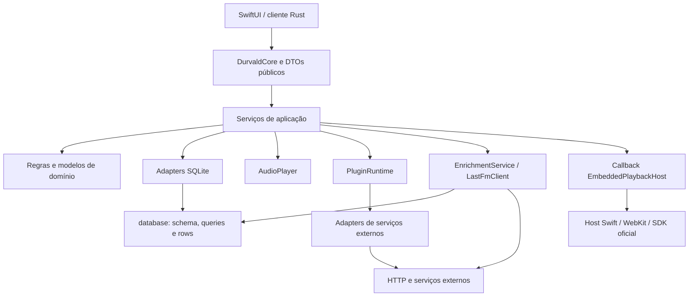
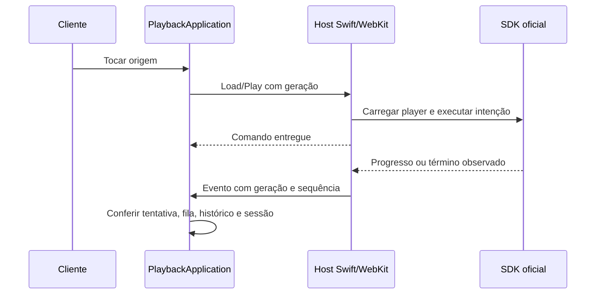

# Guia da arquitetura atual do Durvald Core

Data: 29/10/2026. Escopo: código presente na árvore de trabalho, incluindo alterações
ainda não commitadas. Este guia descreve a implementação, não o desenho futuro.

Leia as seções 1–3 para entender a organização; a seção 4 acompanha os casos de
uso; as seções 5–8 explicam integrações, bibliotecas, persistência e aderência.
O [anexo da API](referencia-api-core.md) permite consultar todos os métodos,
assinaturas e tipos públicos sem precisar memorizá-los.

Atalhos de leitura:

- [Organização do core](#1-o-que-o-core-faz-e-onde-ele-termina).
- [Distinções entre os dados](#2-quatro-distinções-que-evitam-a-maior-parte-da-confusão)
  e [dicionário de estruturas](#3-dicionário-das-principais-estruturas).
- [Casos de uso](#4-casos-de-uso-do-pedido-aos-efeitos).
- [Portas e integrações](#5-portas-e-integrações-quem-implementa-cada-contrato)
  e [bibliotecas](#6-bibliotecas-externas-e-o-trabalho-que-realmente-fazem).
- [Persistência e concorrência](#7-onde-ficam-os-dados-e-como-o-trabalho-é-coordenado).
- [Aderência arquitetural](#8-aderência-às-regras-arquiteturais-definidas)
  e [implementação versus proposta](#9-o-que-está-implementado-e-o-que-ainda-é-arquitetura-proposta).

## 1. O que o core faz e onde ele termina

O core é uma biblioteca Rust, organizada como um **monólito modular**. Ele mantém
catálogo e valores pessoais, coordena reprodução, importa arquivos, consulta
serviços e persiste estado. Não é um servidor público nem um conjunto de
microsserviços. O módulo `api` contém contratos Rust/UniFFI, não rotas HTTP.

O cliente macOS chama esses contratos pelos bindings UniFFI. GTK pode consumir a
biblioteca Rust diretamente; isso não significa que sua interface já implemente
todas as funções disponíveis no core. O macOS também hospeda os players externos
em WebKit e reporta eventos ao Rust: o core não executa o SDK JavaScript sozinho.



As setas mostram dependências reais, inclusive colaboradores concretos e módulos
legados. Não representam uma arquitetura hexagonal totalmente desacoplada.

| Local | Responsabilidade atual | Não deve ser confundido com |
| --- | --- | --- |
| [`src/lib.rs`](../src/lib.rs) | Define visibilidade e reexports deliberados. | Um lugar para implementar casos de uso. |
| [`src/api.rs`](../src/api.rs) e `api/` | DTOs, enums, erros, callback público e serialização/UniFFI. | Tabelas SQL ou uma API HTTP. |
| [`src/core.rs`](../src/core.rs) | Fachada: recebe intenções, valida/converte IDs e encaminha chamadas. Também define objetos de sessão. | Dono de toda a lógica musical. |
| [`src/composition.rs`](../src/composition.rs) | Cria banco, adapters, player, registry e aplicações; restaura estado inicial. | Fluxo de uma busca ou de uma importação. |
| [`src/application/`](../src/application) | Coordena operações, confirmações, geração/cancelamento, fila, importação e políticas. | Necessariamente uma camada só de traits: hoje usa vários adapters concretos. |
| [`src/domain/`](../src/domain) | IDs, regras de fila, contexto, Replay, playlists inteligentes e contratos musicais. | Schema completo do MusicBrainz. |
| [`src/infrastructure/`](../src/infrastructure) | Adapters de SQLite, extração local e integrações externas. | Uma API diretamente acessível pelo cliente. |
| [`src/database/`](../src/database) | Schema, migrações, rows e operações SQL de baixo nível. Continua em uso. | Código morto substituído por `infrastructure/sqlite`. |
| [`src/audio/`](../src/audio), `enrichment/`, `metadata*`, `lastfm.rs`, `secure_store.rs` | Subsistemas especializados preservados pela migração incremental. | Pastas que obrigatoriamente deveriam ter sido eliminadas. |

**Exemplo do caminho normal:** `core.track(id)` → `LibraryApplication` →
`SqliteCatalogTrackQuery` → operação SQL → `CatalogTrack` → DTO `Track` → cliente.
`application/` decide o caso; o adapter conhece a tecnologia; o DTO descreve a resposta.

## 2. Quatro distinções que evitam a maior parte da confusão

### 2.1 DTO, domínio e row não são a mesma estrutura

| Representação | Exemplo | Para que serve |
| --- | --- | --- |
| DTO público | `api::Track`, `CatalogPage`, `DownloadTransferJob` | Atravessar a fronteira do cliente com dados deliberados. |
| Modelo interno | `domain::CatalogTrack`, `TrackId`, `PlaybackSessionState` | Expressar identidade e regras sem uma conexão SQLite. |
| Row/persistência | `database::models` e queries dos adapters | Representar e ler/gravar o armazenamento. |
| Resposta do fornecedor | JSON de MusicBrainz, YouTube ou slskd | Ser validada e normalizada pelo adapter; não virar contrato bruto do cliente. |

`Track.id` é `i64` no DTO; internamente, vários caminhos convertem para `TrackId`.
`Track.file_path` é `Option<String>`: uma faixa remota pode existir sem arquivo.
Os modelos não são cópias idênticas: por exemplo, duração pública pode ser `f64`,
enquanto o catálogo interno usa segundos inteiros. As conversões são explícitas.

### 2.2 Faixa, origem, contexto, ocorrência e tentativa

Considere uma faixa pessoal com `track_id=42` e duas origens: arquivo FLAC e link
SoundCloud. Colocá-la duas vezes na fila não cria duas faixas nem duas origens;
cria **duas ocorrências**. Cada execução pode ter sua própria **tentativa**.

| Conceito | Identificador/estrutura | Significado |
| --- | --- | --- |
| Faixa pessoal | `Track.id`, `songs.song_id` | Recebe favoritos, avaliações e relações pessoais. |
| Origem de mídia | `TrackSource.source_id` | Arquivo/link do serviço que pode fornecer a reprodução. |
| Contexto de navegação | `source_context`, como `release:42` | De onde a ação de tocar veio: álbum, playlist etc. Não é o provedor de áudio. |
| Ocorrência | `QueueItem.occurrence_id` | Uma inserção específica, mesmo quando repete o mesmo `track_id`. |
| Tentativa | `StoredAttempt.id`; geração do host | Uma execução observada. A geração do host é efêmera; o recibo de conclusão é durável. |

Trocar origem não deve recriar favoritos. Reordenar a fila não deve mudar a
identidade da ocorrência. Um evento atrasado do host antigo não deve concluir
a tentativa atual. Esses são problemas diferentes, protegidos por IDs diferentes.

### 2.3 Descobrir não é salvar, salvar não é tocar

`CatalogEntry` descreve algo externo. `SourceCandidate` descreve uma possível
origem. `DownloadOfferGroup` descreve arquivos oferecidos por um peer. Nenhum
deles, sozinho, equivale a `Track` salvo, download concluído ou áudio disponível.

- Consultar retorna resultados temporários/cache.
- Salvar/associar/materializar é uma ação explícita que pode alterar a biblioteca.
- Resolver prepara o modo de reprodução perto da execução.
- Reproduzir precisa de renderer/host e eventos observados.
- Baixar e importar um arquivo são etapas independentes da reprodução de links.

### 2.4 Um serviço pode ter várias integrações independentes

SoundCloud tem um modo de reprodução incorporado e um leitor OAuth de coleções.
YouTube tem IFrame e um leitor Data API. Funcionamento do player sem chave não
comprova funcionamento da API de catálogo. As flags e capacidades são independentes.
O projeto ainda não implementou os extratores sem chave do novo roteiro.

## 3. Dicionário das principais estruturas

Os campos abaixo são selecionados para explicar o comportamento. Todos os campos
e as variantes públicas podem ser consultados no [anexo](referencia-api-core.md).

| Estrutura | Campos/conceito importantes | Vida e dono |
| --- | --- | --- |
| `CoreConfig` | `database_path`, `app_support_dir`, `covers_dir`, `keychain_service` | Entrada da composição; caminhos definidos pelo chamador. |
| `CoreError` / `CoreResult<T>` | `InvalidInput`, `NotFound`, `Storage`, `Playback`, `Authentication`, `Network` | Erros da fronteira pública, sem expor tipos de SQLite/HTTP. |
| `Track`, `Release`, `Artist` | IDs e metadados públicos; arquivo opcional na faixa. | Leitura da biblioteca pessoal. |
| `CatalogReference`, `CatalogEntry` | `provider`, `kind`, `external_id`; título/crédito/URL canônica. | Identidade externa e seleção; não contém o stream resolvido. |
| `CatalogQuery`, `CatalogPage` | Query, escopo, filtro, cursor, idioma, `generation`, cache e falha. | Uma sessão de busca; página de um provedor. |
| `CatalogDetailRequest/Page` | Referência e seção: básico, capa, perfil, edições, tracklist, discografia, similares. | Detalhes independentes, sem carregar tudo obrigatoriamente. |
| `SourceCandidate`, `SourceSearchPage` | Token de candidato, capacidade observada e geração. | Sessão temporária; o token não é reutilizável em outra sessão/item. |
| `TrackSource` | Faixa, provedor, ID externo, arquivo/link, prioridade, preferência, habilitação. | Origem persistente; `availability` é string no DTO atual, embora haja enum interno. |
| `ResolvedMedia` | Localização local/incorporada/externa ou contrato de áudio nativo; expiração. | Interno e temporário. Existir a variante `NativeAudio` não prova transporte HTTP implementado. |
| `PlaybackSnapshot`, `QueueItem` | Estado, posição, fila, contexto, ocorrência, shuffle/repeat. | Visão normalizada da coordenação, não cópia integral do renderer. |
| `EmbeddedPlaybackCommand/Event` | Geração, tipo, sequência e posição; `Load/Stop`, `Ready/Progress/Ended`. | Comunicação Rust ↔ host; resposta ao comando não prova que o áudio começou. |
| `PlaybackHistoryItem`, `StoredAttempt` | Origem, sessão/tentativa, duração efetiva e tempo ouvido. | Histórico/recibos e sessão recuperável. |
| `DownloadSearchRequest/Page` | Query, faixas esperadas, grupos, estado, truncamento e limpeza pendente. | Pesquisa Soulseek temporária, não coleção importada. |
| `DownloadTransferJob/File` | Arquivos, bytes, estado, mapeamentos e recibo `imported_track_id`. | Diário persistente de aquisição. |
| `DownloadImportPreview` | Metadata inspecionada, destino e `review_token`. | Revisão vinculada ao arquivo observado; não é confirmação de importação. |
| `ServiceCollectionJob/Item` | Cursor/páginas, ocorrências, acesso, falha e `saved_track_id`. | Captura persistida e recibos de importação por ocorrência. |
| `ArtistIdentity`, `ArtistIdentityCandidates` | MBID, origem/confirmação, candidatos e estado da consulta. | Enriquecimento; um nome igual não resolve homônimo automaticamente. |
| `ArtistDetails`, `ArtistProfile`, `EnrichmentAttribution` | Perfil normalizado, procedência, retrato e campos pessoais. | Snapshot offline e apresentação de créditos. |
| `ArtistRefreshRequest/Result` | Seções solicitadas, status/diagnóstico e progresso de capas. | Atualização explícita e limitada por seção. |
| `ExternalReleaseGroup/Details` | Grupo externo, edições, tracklist e capa observada. | Cache remoto, distinto de um `Release` pessoal. |
| `Playlist`, `SmartPlaylistDefinition`, `ReplayRequest/Preview` | Lista comum, regras dinâmicas e retrospectiva por período. | Playlists locais; Replay deriva de histórico, não de chamadas remotas. |
| `AlbumCollection`, `ListenListEntry`, `UserTag`, `ClassificationTerm` | Coleção de álbuns, ouvir depois, tags pessoais e classificação musical. | Capacidades pessoais diferentes, não formatos alternativos da fila. |
| `PluginManifest`, `PluginContext`, `RequestTicket` | Capacidades/permissões, configuração, segredo e cancelamento. | Internos ao registry; não são instalação de código arbitrário. |
| `IntegrationDiagnostics` | Contadores e medições limitadas por operação/resultado. | Diagnóstico em memória; ler não inicia sondagem de rede. |

## 4. Casos de uso, do pedido aos efeitos

### 4.1 Abrir o aplicativo

`DurvaldCore::open(config)` é a entrada Rust. Com a feature `uniffi`, a função
livre `open(config)` é a fábrica FFI. Ela devolve um handle `Arc<DurvaldCore>`.

[`compose`](../src/composition.rs) prepara diretórios, pool SQLite, schema/migrações,
sessão, áudio, Last.fm, registry e aplicações. O pool ativa WAL, foreign keys e
`busy_timeout`. O core inicia coordenação automática da reprodução. Abrir não
significa pesquisar automaticamente em todos os serviços ou importar catálogo.

### 4.2 Escanear arquivos e consultar a biblioteca

**API:** `add_library_path`, `library_paths`, `scan_configured_library`,
`scan_library`, `scan_progress`, `cancel_library_scan`; leitura com `tracks_page`,
`releases_page`, `artists`, `track`, `release`, `artist_tracks`, `release_tracks`.

**Caminho:** `LibraryApplication` → `SqliteLibraryScanRepository` e
`LocalMetadataExtractor` → metadata local → adapters de catálogo/SQLite.
`lofty` lê tags; `image` trata arte; o scanner usa os formatos habilitados.

Há exclusão de scans concorrentes e cancelamento cooperativo. Scan interrompido
não deve fazer reconciliação destrutiva de arquivos ausentes. A fila de edição
de metadata evita disputar os mesmos arquivos com importação/edição.
O catálogo suporta faixa sem arquivo e origens adicionais; arquivo ausente não
significa apagar histórico ou a faixa remota correspondente.

### 4.3 Buscar catálogo e abrir detalhes

`search(query)` é a busca da biblioteca. A busca de catálogo usa outro objeto:

```text
core.catalog_search_session()
  → session.search_page(provider, CatalogQuery)
  → session.detail_section(CatalogDetailRequest), quando solicitada
  → session.cancel(generation) ou session.close()
```

**Caminho:** `CatalogSearchApplication` → SQLite local ou plugin MusicBrainz.
`CatalogProvider` atualmente tem `Library` e `MusicBrainz`. O cliente pede páginas
por provedor; não existe ainda fan-out HTTP global de addons no estilo Stremio.
O índice local já usa FTS5 trigram. A normalização interna observada junta espaços
e aplica minúsculas; não confundir isso com toda a tolerância a acentos/typos do plano.

`generation` identifica a intenção de busca. Resultado de uma geração anterior
é cancelado/descartado; reutilizar a geração com outra query é inválido.
Detalhes são carregados por seção. Salvar é separado: `save_catalog_selection`,
`save_remote_track`, `materialize_remote_artist`, `follow_catalog_artist` e
`add_catalog_to_listen_list` possuem efeitos pessoais distintos.

### 4.4 Descobrir e associar uma origem

**API:** `source_search_session()` → `search(provider, entry, link, generation)` →
`attach_candidate(candidate_id, track_id, confirmed)`; `preview_candidate` é uma
intenção de reprodução explícita. Encerrar com `close()`.

**Caminho:** `SourcesApplication` → `PluginRuntime` → `SourceFinder`; associação
persistente usa `SqliteSources`. O adapter atual `service-links` reconhece links
de serviços e expande links curtos SoundCloud; isso não é busca textual geral
no catálogo do SoundCloud/YouTube.

`soundcloud_link_entry` valida um permalink com nomes fornecidos pelo usuário;
`resolve_soundcloud_link_entry` também pode expandir link curto. Nenhum dos dois
comprova pelo título que a gravação é correta. `track_sources`, `test_track_source`,
`prefer_track_source`, `set_track_source_enabled`, `remove_track_source` e
`attach_local_track_source` gerenciam a origem após a associação.

### 4.5 Reproduzir arquivo local e coordenar a fila

**API:** `play`, `play_with_context`, `play_collection`, `play_track_source`,
`pause`, `resume`, `stop`, `seek`, `next_track`, `previous_track`; fila por
`add_to_queue*`, `play_queue_item`, `move_queue_item`, `remove_from_queue`, `clear_queue`.

**Caminho:** `PlaybackApplication` → política de origem → preparação do arquivo →
`AudioPlayer` → decoder/Kira/backend de áudio. O renderer possui trabalho próprio;
consultar `playback()` apresenta estado, não é o relógio que faz a música avançar.
O coordenador também reconcilia término, sessão, histórico e Last.fm.

[`audio.rs`](../src/audio.rs) aceita MP3, WAV, FLAC e Ogg Vorbis (`ogg/oga`). O
pré-carregamento/gapless local não significa que exista streaming HTTP/HLS nativo.
O formato Opus/AAC citado no novo roteiro ainda não está habilitado no caminho local.

### 4.6 Reproduzir SoundCloud/YouTube incorporados

**API:** `set_embedded_playback_host`, `play_embedded_track_source`,
`report_embedded_playback_event`, `embedded_playback`, `detach_embedded_playback_host`;
flags `set_soundcloud_playback_enabled` e `set_youtube_playback_enabled`.



O callback [`EmbeddedPlaybackHost`](../src/api/embedded.rs) é a exceção deliberada
em que a API define uma porta implementada pelo cliente. A mailbox ordena comandos;
`Stop` precisa silenciar/destruir o player antigo antes de confirmar. Eventos com
geração/ordem erradas e conclusões duplicadas são rejeitados. Inatividade/progresso
parado têm recuperação; a fila não deve desaparecer em timeout.

O [controlador Swift](../../durvald-macos/Durvald/Durvald/Features/Player/EmbeddedPlayerController.swift)
usa o SoundCloud Widget ou YouTube IFrame. O servidor loopback usado pela página
YouTube fornece origem HTTP ao IFrame; **não é o gateway de catálogo proposto no
roteiro Stremio**. A verificação de vídeo finito/incorporável tem política própria.

### 4.7 Registrar histórico e restaurar sessão

**API:** `playback_history*`, `remove_playback_history_item`,
`clear_playback_history`, `last_session`, `save_session`.

`PlaybackSessionState` cuida de fila, navegação e ocorrências. `StoredAttempt`
preserva evidências e vínculo da tentativa sem persistir URL de mídia ou geração
do host. `playback_attempts.rs` e a coordenação incorporada consolidam duração
efetiva e tempo ouvido; os recibos SQLite impedem concluir duas vezes a mesma sessão.
Posição após seek não é o mesmo que tempo ouvido. Histórico de navegação da fila
também não é a lista persistida de escutas.

### 4.8 Pesquisar Soulseek e transferir

**Pesquisa:** `configure_download_search` → `download_search_session()` →
`search(request, generation)` → `poll(generation)` → `cancel()`/`close()`.
**Transferência:** `session.enqueue_download(offer_id, filenames, confirmed)` →
`refresh_download_transfer`; cancelamento/retry têm métodos próprios.

O core conversa por HTTP com **slskd externo**, que mantém a conexão Soulseek e
executa a transferência. O core não implementa diretamente o protocolo P2P nem
inicia automaticamente um daemon. A configuração atual slskd continua exigindo
sua chave; a decisão futura sem chaves pessoais de YouTube/SoundCloud não remove
essa autenticação da instância slskd.

`DownloadSearchApplication` mantém ofertas temporárias. `DownloadTransfersApplication`
coordena o diário durável e `DownloadTransferProvider`; o adapter de slskd verifica
identidades/recibos. `SubmissionUnknown` significa que não é seguro supor falha e
reenviar cegamente: pode já haver uma solicitação no backend.

### 4.9 Importar o arquivo transferido

**API:** `pending_download_import`, `inspect_download_file`, `import_download_file`.

1. Mapear a pasta remota do backend para uma pasta local confirmada.
2. Localizar e inspecionar o arquivo, validar tamanho/conteúdo/áudio e obter preview.
3. Confirmar a revisão com `review_token`, destino e eventual faixa alvo.
4. Coordenar cópia gerenciada, publicação no catálogo e recibo persistente.

[`acquisition_files.rs`](../src/infrastructure/acquisition_files.rs), metadata e
`TransferRepository` fornecem os efeitos; `ImportJournal` permite reconhecer e
retomar trabalho entre filesystem e banco. Não existe uma única transação ACID
englobando os dois. Caminho remoto ou download `Completed` não basta para criar
uma origem local reproduzível. Importar não inicia áudio ou scrobble.

### 4.10 Capturar e importar uma coleção de serviço

**API:** `configure_service_import` → `begin_service_collection_import(url)` →
`load_service_collection_page` → revisão → `import_service_collection_items`.
`retry_service_collection_page`, `cancel_service_collection_import` e
`resume_service_collection_import` trabalham sobre a mesma captura persistente.

**Caminho:** `ServiceCollectionsApplication` → `ServiceCollectionReader` pelo
registry → `PublicService` Bandcamp/SoundCloud/YouTube → página normalizada →
`ServiceCollectionRepository` e cache/diário.

Cada item tem `occurrence_id`, posição, acesso, falha e recibo. Duas ocorrências da
mesma gravação podem compartilhar a faixa e manter duas posições na playlist.
A confirmação importa somente itens selecionados/elegíveis; itens ausentes ou
restritos continuam visíveis sem faixas fictícias. Reabrir/reconfirmar não deve
duplicar a associação nem sobrescrever edições pessoais.

Os leitores atuais são: Bandcamp público, SoundCloud com token OAuth e YouTube
Data API com chave. O executor de prova isolada foi preparado, mas o usuário
decidiu não fornecer essas credenciais; os novos leitores sem chave seguem planejados.

### 4.11 Enriquecer artista, discografia e capas

**API de leitura:** `artist_details`, `artist_discography`, `artist_popular_tracks`,
`external_release_details`, `artist_identity`.
**Ações:** `resolve_artist_candidates`, `confirm_artist_identity`, `refresh_artist`,
`set_artist_override`, `clear_artist_override`, `sync_artist_release_metadata`.

`EnrichmentApplication` delimita o caso e chama `EnrichmentService`. Este serviço
concentra planejamento, cache, publicação SQLite e adapters de fornecedores.
MusicBrainz identifica; Wikidata relaciona; Wikipedia fornece texto; Commons
fornece metadados/arquivo do retrato; CAA fornece arte de lançamento; Last.fm tem
perfil/similares/faixas populares conforme configuração e resposta disponíveis.

As leituras de snapshots não são equivalentes a atualizar a rede. Refresh é por
seção; capas possuem fila persistente e resultados negativos para não repetir
ausências continuamente. Identidade/geração e overrides pessoais são conferidos
antes de publicar resultados. `artwork_bytes` lê um asset gerenciado validado,
não uma URL arbitrária enviada pelo cliente.

### 4.12 Organizar e editar a biblioteca pessoal

| Caso | Principais métodos | Responsáveis e efeitos |
| --- | --- | --- |
| Playlists comuns | `create_playlist`, `update_playlist`, `add_track_to_playlist`, `remove_track_from_playlist`, `move_playlist_track` | `PlaylistApplication` e `SqlitePlaylistRepository`; posições e repetições locais. |
| Playlists inteligentes | `create_smart_playlist`, `update_smart_playlist` | Regras em `domain/smart_playlist.rs`; avaliação/consulta no banco. |
| Replay | `replay_preview`, `save_replay`, `update_replay` | Política em `domain/replay.rs`; geração a partir de histórico, salvamento explícito. |
| Coleções de álbuns | `album_collections`, `save_album_collection`, `add_album_to_collection`, `album_collection_tracks` | `LibraryApplication` e `SqlitePersonalLibraryRepository`; coleção de lançamentos, distinta de playlist de faixas. |
| Gêneros/estilos | `classification_terms`, `classification_page`, `set_classification`, `set_style_genres` | Mesma aplicação/repositório pessoal; relações musicais e filtros. |
| Ouvir depois | `listen_list`, `add_release_to_listen_list`, `add_external_to_listen_list`, `set_listen_list_heard` | Entrada pessoal local/externa; marcar ouvido não simula uma reprodução. |
| Tags pessoais | `create_user_tag`, `update_user_tag_links`, `filter_user_tag_items` | Organização explícita, diferente de gêneros de fornecedor. |
| Favoritos/notas/ocultação | `set_*_favorite`, `set_*_rating*`, `set_*_hidden`, `set_*_suggest_less` | Aplicações de biblioteca/playlist e repositórios; escala e conversões têm contratos próprios. |
| Home/recomendações | `home_library`, `local_recommendations`, `record_recommendation_event`, `dismiss_local_recommendation` | Dados locais e preferências pessoais; não dependem de um serviço remoto de recomendação. |
| Seguir/novidades | `set_artist_followed`, `followed_artists`, `artist_news`, `refresh_artist_news` | Preferências e feed persistidos; atualização usa identidade e geração do follow. |
| Edição/reparo | `track_info`, `save_track_metadata`, `undo_track_metadata`, `analyze_library_repairs`, `merge_library_records` | `MetadataApplication`, `SqliteTrackMetadataRepository`, `metadata_edit`/`library_repair`; arquivo só é escrito quando a intenção correspondente o autoriza. |
| Configuração/saída | `settings`, `update_settings`, `audio_output_state`, `select_audio_output_device`, `equalizer_metrics`, `spectrum_snapshot` | `SettingsApplication`, `AudioPlayer` e persistência; parâmetros não são acesso direto ao dispositivo pelo cliente. |
| Last.fm | `configure_lastfm`, `lastfm_auth_token`, `complete_lastfm_auth`, `disconnect_lastfm`, `lastfm_status` | `LastFmApplication`/`LastFmClient` e secure store; autenticação/scrobbling independentes de salvar uma faixa. |

Letras atuais: `track_lyrics` consulta a infraestrutura de metadata; não significa
que o novo addon online de letras descrito no roteiro já exista.

## 5. Portas e integrações: quem implementa cada contrato

Uma **porta** é um comportamento que a aplicação pede sem receber a implementação
concreta; no código costuma ser uma `trait`. Um **adapter** traduz esse comportamento
para HTTP, SQLite, arquivo ou SDK. Nem todo adapter atual está atrás de uma trait.

| Porta/colaborador | Implementação/uso atual | Limite |
| --- | --- | --- |
| `CatalogReader` | MusicBrainz pelo registry; SQLite local participa por query concreta. | Busca/detalhes não adotam automaticamente dados pessoais. |
| `SourceFinder` | `service-links`. | Reconhecer/expandir link não equivale a busca textual nos serviços. |
| `MediaResolver` | `SoundCloudPlayback` e `YouTubePlayback`. | Resolvem modo incorporado; não entregam áudio HTTP nativo. |
| `DownloadSearcher` / `DownloadSearchHandle` | `SlskdSearch`. | Oferta temporária, polling e cancelamento. |
| `DownloadTransferProvider` | Implementação slskd associada à integração. | Diário de transferência e recibos separados da busca. |
| `ServiceCollectionReader` | `PublicService` com três leitores. | Metadados públicos autorizados conforme o serviço; salvar usa aplicação/repositório. |
| `PluginStateStore` | `FilePluginStateStore`. | Preferências/configuração em arquivo; não guarda o segredo junto da flag. |
| `PluginCredentialStore` | `PlatformPluginCredentials` → secure store. | Segredos no serviço de credenciais da plataforma. |
| `EmbeddedPlaybackHost` | Host Swift/WebKit. | Executa intenção e retorna eventos; não decide recibos do histórico. |
| Repositórios `Sqlite*` | Construídos diretamente na composição e injetados em aplicações. | São adapters concretos, sem trait genérica obrigatória. |

As portas estão principalmente em [`music_catalog.rs`](../src/application/music_catalog.rs),
[`music_plugins/mod.rs`](../src/application/music_plugins/mod.rs),
[`transfer_ports.rs`](../src/application/transfer_ports.rs) e
[`service_collection_ports.rs`](../src/application/service_collection_ports.rs).
Não há um diretório universal `ports/`; não é requisito para que uma porta exista.

`PluginRuntime` registra adapters internos compilados com o projeto, confere
manifesto/capacidade/permissão/flag e coordena timeout, cancelamento e diagnóstico.
`PluginContext` entrega configuração e segredos necessários à chamada; `PluginSecret`
redige sua representação de debug e usa memória zerável. `RequestScope` invalida
tickets anteriores. A registry não deve acessar a biblioteca pessoal ou o player.

| Integração | O que existe | Acesso/estado relevante |
| --- | --- | --- |
| MusicBrainz | Busca de catálogo e enriquecimento/identidade. | Rede pública com limites/cache; separada do catálogo pessoal. |
| Wikimedia/CAA | Texto, relações, retratos e capas. | APIs públicas e validação de arquivo/atribuição. |
| Last.fm | Autenticação, perfil/similares/populares e now-playing/scrobble. | Configuração e credenciais próprias; não obrigatório para áudio local. |
| SoundCloud | Links, Widget, leitor de coleção. | Widget não exige token pessoal; leitor de coleção atual exige OAuth. |
| YouTube | IFrame e leitura Data API. | Reprodução e leitura têm flags distintas; metadados finitos verificados são parte da política atual de reprodução. |
| Bandcamp | Leitor de faixa/álbum público. | Não comprova transporte nativo nem arquivos comprados. |
| Soulseek/slskd | Pesquisa, transferência e importação do arquivo mapeado. | Instância externa com autenticação própria; rede do trabalho pode limitar provas reais. |
| Spotify/Apple Music/Deezer/iTunes | Avaliação no roteiro visual. | Não são adapters visuais implementados nesta árvore. |
| yt-dlp/FFmpeg, addons HTTP, CDN | Planejamento/provas futuras. | Não são dependências de produção adotadas pelo core atual. |

Um valor em `EnrichmentProvider` ou uma variante em um contrato não comprova
adapter ativo para ele. Conferir composição/registro, implementação e prova real.

## 6. Bibliotecas externas e o trabalho que realmente fazem

Fonte: [`Cargo.toml`](../Cargo.toml), imports e consumidores na árvore. Versões
resolvidas pertencem a `Cargo.lock`; esta tabela explica responsabilidades.

| Biblioteca | Usada para | Onde entra |
| --- | --- | --- |
| Tokio | Tasks, mutexes/canais, cancelamento cooperativo e fronteira de trabalho bloqueante. | Aplicações, runtime, HTTP e coordenação. `async` sozinho não torna SQLite/decoder não bloqueante. |
| rusqlite + r2d2/r2d2_sqlite | SQLite síncrono e pool de conexões. | Composição, adapters e módulos `database`; operações demoradas usam fronteiras de execução apropriadas. |
| Kira | Renderização/controle de áudio, sons preparados e reprodução. | `AudioPlayer`, equalização/gapless. Não é um catálogo nem resolve links externos. |
| CPAL | Backend/dispositivos de saída de áudio. | Player; não é cliente HTTP. |
| Symphonia | Demux/decodificação dos formatos habilitados. | `audio/decoder.rs`; também valida conteúdo de aquisição. |
| rtrb | Comunicação por ring buffer no caminho de áudio. | Gapless/análise/equalização, evitando trabalho pesado na callback. |
| lofty | Ler/escrever tags e arte embutida de arquivos. | `metadata.rs`/`metadata_edit.rs`; não consulta discografia online. |
| image / png | Validar, decodificar e normalizar arte nos formatos habilitados. | Metadata, artwork e transporte visual. AVIF futuro não está automaticamente habilitado. |
| reqwest + url | Requisições HTTP e parsing/validação de URLs. | Transporte de enriquecimento, serviços públicos e slskd. |
| scraper | Parsing de HTML observado pelo leitor público. | Bandcamp; não substitui um resolvedor universal de streaming. |
| serde / serde_json | Serializar DTOs, preferências, cache e diários versionados. | API, sessão, persistência e adapters. JSON interno não significa endpoint HTTP existente. |
| keyring + ring + zeroize | Serviço de credenciais da plataforma, compatibilidade/migração criptográfica e segredos zeráveis. | `secure_store.rs` e credenciais de plugins. |
| sha2 / md-5 / base64 | Identificadores/digests, assinaturas e codificações conforme o caso. | Aquisição, arte/cache e Last.fm; hash não confirma identidade musical. |
| UniFFI | Exportar objetos, DTOs, erros e callback para Swift. | Feature `uniffi`, bindgen e biblioteca nativa. Não gera o host WebKit. |
| chrono / icu_normalizer | Datas e normalizações específicas dos consumidores. | Histórico/Replay/identidade; não são um motor completo de busca tolerante a typos. |

Uma dependência declarada não é prova de uso efetivo em todos os casos. Por
exemplo, `tokio-rusqlite` consta do manifesto, mas o caminho de pool inspecionado
usa `rusqlite`/`r2d2`; não atribuir a ela o isolamento de todas as consultas.
WebKit/SwiftUI são bibliotecas do cliente macOS, fora do `Cargo.toml` do core.

## 7. Onde ficam os dados e como o trabalho é coordenado

| Estado | Local/implementação | Propriedade importante |
| --- | --- | --- |
| Biblioteca, valores pessoais e relações | Banco definido em `CoreConfig.database_path`; `database/operations.rs` e módulos especializados. | IDs e integridade referencial; páginas e queries não são uma biblioteca paralela. |
| Origens e referências externas | `track_sources`, estado/metadata/preferências de origem, `catalog_track_references`. | Arquivo e URL canônica são distintos de URL temporária de mídia. |
| Fila/sessão/histórico | `last_session`, `play_history`, revisão e `playback_completion_receipts`. | Ocorrências e recibos permitem restauração e conclusão idempotente. |
| Transferências | `download_transfer_settings`, `download_transfer_jobs`; payloads de diário. | Retomada reconhece submissão/importação, não reenvia cegamente. |
| Coleções | `service_collection_jobs`, `service_collection_cache`, `service_media_policy`. | Captura por URL, páginas e recibos por item; política YouTube tem verificação temporal. |
| Enriquecimento | Tabelas de identidade, perfis, grupos externos, assets, snapshots e fila/negativos de capas. | Overrides e resultado de fornecedor têm procedência independente. |
| Arquivos de arte | Diretório `covers_dir`, referências gerenciadas e leitura validada. | Não aceitar acesso arbitrário fora do diretório, inclusive por symlink. |
| Configuração de plugins | `app_support_dir/music-plugins.json`. | Flags/configuração sem confundir com os segredos da plataforma. |
| Segredos | Keyring/Keychain via secure store; compatibilidade de formatos antigos é migração. | Não pertencem a resultados/cache compartilhável de catálogo. |
| Tickets, candidatos, host e contadores | Memória de sessões/runtime. | Não têm garantia de sobreviver ao reinício como um job persistido. |

As migrações numeradas inspecionadas vão até 26; outras tabelas também são criadas
pelos inicializadores especializados. Não inferir o schema somente de um arquivo.
`database_path` é configurável: `CoreConfig::new` fornece defaults, mas o app pode
passar outros caminhos. O core não é proprietário de todos os arquivos da pasta musical.

**Concorrência:** `Arc` compartilha a posse dos serviços; mutexes protegem estado,
transições e publicação; `spawn_blocking` isola trabalho síncrono em vários adapters.
Nenhum desses mecanismos substitui transação/recibo. A fila de metadata é compartilhada
entre scan, edição e aquisição; geração/ticket controla resultados obsoletos; uma
transação SQLite publica mudanças relacionadas. Chamada de rede não deve manter
transação de escrita aberta enquanto espera o fornecedor.

**Erros em dois níveis:** `Err(CoreError)` relata falha do comando/fronteira.
`Ok(CatalogPage { failure: ... })` e jobs/resultados semelhantes podem conter falha
de negócio/provedor ou resultado parcial. O cliente precisa inspecionar o payload,
não apenas tratar exceções. Cancelamento cooperativo também não promete interromper
um decoder síncrono no meio de uma chamada de biblioteca.

## 8. Aderência às regras arquiteturais definidas

Referências normativas do projeto:
[roteiro direto](arquitetura/roteiro-implementacao-direto.md), especialmente Marcos
6–7, e [direção das dependências](arquitetura/roteiro.md), Fase 17.
O primeiro permite adapters concretos e abstrações seletivas; o segundo descreve
um endurecimento mais amplo como objetivo. Não são prova de que todo o código já
satisfaça uma arquitetura hexagonal estrita.

| Regra | Estado observado | Evidência e limite |
| --- | --- | --- |
| Uma crate modular, sem abstração por formalidade | Aderente ao roteiro pragmático. | `lib.rs` privado e composição; não foi imposta trait genérica para cada query. |
| Fachada sem SQL/rows/execução genérica de banco | Aderente ao guard atual. | `core.rs` encaminha casos e converte IDs; teste verifica ausência dos padrões de banco. |
| Toda chamada atravessa método nomeado de aplicação | Parcial. | `service_collection_import` acessa `service_collections.repository.get` diretamente pela fachada. Não há SQL ali, mas não é delegação estrita de todas as leituras. |
| Aplicação sem detalhes de rusqlite/pool/operations | Aderente ao conjunto textual testado. | Guard recursivo proíbe padrões específicos em `application/`. Não prova ausência de dependência transitiva. |
| Aplicação depende só de portas abstratas | Não é a implementação atual nem requisito de todo adapter no roteiro direto. | Library/Playback/Sources/Coleções recebem tipos concretos `Sqlite*`, `AudioPlayer` e serviços. |
| Domínio independente de API/infra/transporte | Aderente no recorte protegido `domain/music`; parcial no domínio inteiro. | `domain/replay.rs`, `playlist.rs`, `settings.rs` e `smart_playlist.rs` ainda usam tipos de `crate::api`. Não usam esses tipos como conexão SQL, mas há acoplamento de modelos. |
| Composição centralizada | Majoritariamente aderente. | `compose` monta o grafo; algumas aplicações registram seus builtins em `new`/inicialização. Não é composição exclusiva de toda construção. |
| Enriquecimento separado em fronteira pura de aplicação | Parcial. | `EnrichmentApplication` envolve `EnrichmentService`, que ainda possui pool, operações de banco e transportes. É subsistema integrado, não só regra pura. |
| Efeitos de arquivo totalmente atrás de portas | Parcial. | `MetadataApplication` chama extração e leitura de arte em `spawn_blocking`; filesystem não está todo atrás de uma trait. |
| Persistência independente dos detalhes de coordenação | Acoplamento explícito a observar. | Repositórios de coleções/transferências serializam tipos de diário definidos em `application/`. Isso facilita retomada, mas liga a forma persistida à aplicação. |
| API sem tipos de infraestrutura | Aderente ao recorte público inspecionado. | DTOs/handles/erros deliberados; `test_support` é exceção sob feature. Callback de host é contrato deliberado, não vazamento de WebKit. |
| Registry isolada de biblioteca/player | Aderente ao guard atual. | Teste específico proíbe dependências de player/biblioteca no registry. A aplicação faz a adoção dos resultados. |
| Separar descoberta, adoção, resolução e transferência | Implementado nos casos e contratos descritos. | Sessões/candidatos/jobs diferentes; confirmação e recibos. Comportamento depende dos respectivos testes, não só de nomes de módulos. |
| URLs/segredos temporários fora da identidade persistente | Intenção explícita e contratos específicos. | Referência canônica, credenciais separadas e geração/lease interna. Este guia não é auditoria exaustiva de segurança de todos os payloads. |

Os seis testes em [`architecture_boundaries.rs`](../tests/architecture_boundaries.rs)
passaram nesta redação, com
`cargo test --locked --offline --manifest-path durvald-core/Cargo.toml --test architecture_boundaries`.
Eles verificam: ausência de padrões de banco na aplicação; ausência de bypass SQL
na fachada; regras de playlists independentes de armazenamento; registry isolada;
exports deliberados; e independência dos contratos `domain/music`.

São verificações textuais, não análise AST/grafo transitivo: comentários e strings
podem influenciar resultados, e várias dependências não estão na lista proibida.
Seis passes não significam “100% de aderência arquitetural”. Não foi executada
uma nova suíte completa, prova remota ou build de todos os clientes para este guia.

### Como aplicar as regras ao próximo desenvolvimento

1. Nomear o caso e sua aplicação antes de escolher uma pasta ou biblioteca.
2. Manter entrada/saída pública em `api`; colocar conversões nas fronteiras.
3. Criar regra pura em domínio quando houver regra real; não levar conexão/HTTP para ela.
4. Colocar efeito em adapter e criar porta quando houver substituição/isolamento concreto.
5. Injetar dependências pela composição; evitar executor genérico que faça SQL escapar.
6. Preservar identidade, confirmações, cancelamento e recibos nas novas integrações.
7. Testar o comportamento pela API e o limite arquitetural; testar configuração/forma
   do arquivo não substitui observar o caso completo.

## 9. O que está implementado e o que ainda é arquitetura proposta

| Tema recente | Código atual | Próximo desenho |
| --- | --- | --- |
| Busca | SQLite/FTS5 e MusicBrainz por sessão/provedor. | Gateway HTTP/JSON, índice/federação ampliados, ranking e autocomplete evoluídos. |
| Identidade | IDs locais, referências tipadas, MBIDs e associações externas. | Modelo persistido completo obra/gravação/grupo/edição/faixa e mapeamentos mais amplos. |
| Streaming | Arquivos locais e hosts incorporados SoundCloud/YouTube. | Extratores sem chave pessoal e transporte HTTP/HLS nativo. |
| Plugins | Registry de adapters internos confiáveis. | Recursos inspirados no Stremio e addons HTTP opcionais; não marketplace pronto. |
| Visual | Arte local, CAA/Commons e enriquecimento existente. | Serviço de variantes por hash, mais fornecedores e vídeo opcional. |
| Spotify/Apple/Deezer | Sem adapter visual implementado. | Avaliação de acesso/uso, preservando o fluxo sem chaves pessoais. |

O [roteiro R1–R12](../../docs/roteiro-adaptadores-sem-chaves-e-midia-visual.md)
é o destino planejado. O fato de existir nele `GET /search`, CDN, prefetch remoto
ou uma nova estrutura não significa que esses componentes já existam no core.

## 10. Onde começar a ler o código

| Intenção | Sequência curta de leitura |
| --- | --- |
| Entender o grafo | `lib.rs` → campos de `DurvaldCore` → `composition.rs` → construtor da aplicação escolhida. |
| Entender um método público | Assinatura no [anexo](referencia-api-core.md) → método em `core.rs` → serviço de aplicação → adapter → conversão de retorno. |
| Investigar áudio | `application/playback.rs` → `playback_sources.rs`/`playback_embedded.rs`/`playback_attempts.rs` → `audio/player.rs` ou host Swift. |
| Investigar integração | `music_catalog.rs`/porta específica → `music_plugins` → adapter em `infrastructure` → fixture do adapter. |
| Investigar persistência | Repositório `Sqlite*` → módulo de banco usado → schema/migração → teste de reabertura/recibo. |
| Investigar imagem/perfil | `application/enrichment.rs` → `enrichment/service.rs` → provider/transport/cache → persistência e override. |

Testes úteis por caso: [`catalog_search.rs`](../tests/catalog_search.rs),
[`sources.rs`](../tests/sources.rs), [`playback.rs`](../tests/playback.rs),
[`embedded_playback.rs`](../tests/embedded_playback.rs),
[`consolidated_playback.rs`](../tests/consolidated_playback.rs),
[`personal_library.rs`](../tests/personal_library.rs), fixtures de
[`public_services`](../src/infrastructure/public_services/tests.rs) e
[`slskd_transfers`](../src/infrastructure/slskd_transfers/tests.rs).

O [checkpoint da refatoração](estado-refatoracao-arquitetura-core.md) descreve
setembro; a [investigação da fronteira de aplicação](../../docs/features/application-boundary-investigation.md)
registra uma regressão e sua correção em outubro. Não usar as contagens antigas
de serviços/métodos desses documentos como inventário atual. Para atualização
deste guia, conferir primeiro `core.rs`, `api*`, composição e os guards, sem
substituir observação do código por um resumo de roadmap.
